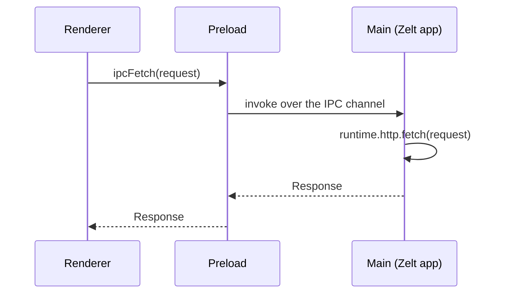

# IPC Bridge

The Electron adapter replaces HTTP sockets with Electron's IPC mechanism. Standard `Request`/`Response` objects are serialized into IPC-safe payloads, sent between processes, and deserialized on the other side — your controllers see the same Web Fetch API as any other adapter.

## How It Works



Text content (JSON, HTML, XML) is serialized as strings; binary content as `ArrayBuffer`.

## Configuration

All three layers must agree on the same channel string:

```typescript
import { createApp, http } from '@zeltjs/core';
import { electronIpc, onElectron } from '@zeltjs/adapter-electron';
import { exposeIpc } from '@zeltjs/adapter-electron/preload';
import { ipcFetch } from '@zeltjs/adapter-electron/renderer';
const app = createApp([http({ controllers: [] }), electronIpc()]);
const input = new Request('http://zelt-app/hello');
const init = undefined;
// ---cut---
// main
const electronZelt = await onElectron(app);
await electronZelt.electronIpc.listen(electronZelt.http, { channel: 'http://zelt-app' });

// preload
exposeIpc({ channel: 'http://zelt-app' });

// renderer
ipcFetch(input, init, { channel: 'http://zelt-app' });
```

The channel must start with `http://` or `https://`. The default is `'http://zelt-ipc'` if omitted.

## Main Process: `onElectron()`

```typescript
import { createApp, http } from '@zeltjs/core';
import { electronIpc, onElectron } from '@zeltjs/adapter-electron';
const app = createApp([http({ controllers: [] }), electronIpc()]);
// ---cut---
const electronZelt = await onElectron(app, {
  warmup: true, // default: resolve all controllers at startup
});
await electronZelt.electronIpc.listen(electronZelt.http, { channel: 'http://zelt-app' });
```

### Options

| Option | Type | Default | Description |
|--------|------|---------|-------------|
| `warmup` | `boolean` | `true` | Resolve all controllers at startup |

### Return Value (`OnElectronApp`)

Each configured feature is namespaced under its key. `electronIpc()` exposes `electronIpc.listen(http, options)`, and `httpServer()` exposes `httpServer.listen(http, options)`. HTTP features do not choose a transport:

| Property | Type | Description |
|----------|------|-------------|
| `http.fetch` | `(request: Request) => Promise<Response>` | Handle a request directly |
| `http.request` | `(input: string \| Request, init?: RequestInit) => Promise<Response>` | Handle a request built from a URL/path and `RequestInit` |
| `electronIpc.listen` | `(http: HttpFetchTarget, options?: ElectronIpcListenOptions) => Promise<ElectronIpcHandle>` | Expose the selected HTTP target over IPC; declare `electronIpc()` |
| `httpServer.listen` | `(http: HttpFetchTarget, options?: HttpListenOptions) => Promise<ServerHandle>` | Serve the selected HTTP feature over TCP; declare `httpServer()` |
| `shutdown` | `() => Promise<void>` | Graceful shutdown |
| `get` | `<T>(Class) => Promise<T>` | Resolve a service from DI |

Breaking change: `onElectron()` no longer accepts `ipcChannel` / `ipcFeature` or registers IPC implicitly. Declare `electronIpc()` and call `electronIpc.listen(targetHttp, { channel })`. Apps without HTTP or IPC features can also start.

### IPC Binding and Shutdown

`electronIpc()` waits for Electron readiness but registers no handler until `listen()` is called. Use `electronIpc({ name: 'desktop' })` to name the feature.

```typescript
import { createApp, http } from '@zeltjs/core';
import { electronIpc, onElectron } from '@zeltjs/adapter-electron';
const app = createApp([http({ name: 'admin', controllers: [] }), electronIpc()]);
const runtime = await onElectron(app);
// ---cut---
const binding = await runtime.electronIpc.listen(runtime.admin, { channel: 'http://admin' });
await binding.shutdown();
```

The returned handle has `channel` and `shutdown()`. Individual shutdown and runtime `shutdown()` share the same cleanup, removing the handler once. Call `listen()` with distinct channels to expose multiple HTTP targets.

### Warmup

By default, `onElectron()` eagerly resolves all controllers at startup (`warmup: true`). This ensures services are initialized before the first request. Set `warmup: false` for lazy initialization on first request.

## Preload Script: `exposeIpc()`

```typescript
import { exposeIpc } from '@zeltjs/adapter-electron/preload';
// ---cut---
exposeIpc({ channel: 'http://zelt-app' });
```

`exposeIpc()` registers an IPC sender function and exposes it to the renderer via `contextBridge.exposeInMainWorld()` (or `globalThis` if context isolation is disabled).

The exposed key is the channel string itself, so `ipcFetch` on the renderer side can look it up from `globalThis[channel]`.

## Renderer: `ipcFetch()`

```typescript
import { ipcFetch } from '@zeltjs/adapter-electron/renderer';
// ---cut---
const response = await ipcFetch('http://zelt-app/hello/world', undefined, {
  channel: 'http://zelt-app',
});
const data = await response.json();
```

`ipcFetch()` has the same signature as `fetch()`, plus an optional third argument for the channel. It converts the request into an IPC payload, sends it through the preload bridge, and returns a standard `Response`.

### Creating a Wrapper

In practice, wrap `ipcFetch` so the channel is configured once:

```typescript
import { ipcFetch } from '@zeltjs/adapter-electron/renderer';
// ---cut---
const CHANNEL = 'http://zelt-app';

export const apiFetch = (input: RequestInfo | URL, init?: RequestInit): Promise<Response> =>
  ipcFetch(input, init, { channel: CHANNEL });
```

### Using with Hono Client

For type-safe API calls, combine with [`@zeltjs/hono-client`](../hono-client):

```typescript
import { ipcFetch } from '@zeltjs/adapter-electron/renderer';
declare function hc<T>(baseUrl: string, options?: { fetch: (input: RequestInfo | URL, init?: RequestInit) => Promise<Response> }): T;
// AppType is generated by @zeltjs/hono-client from your app definition
declare type AppType = Record<string, unknown>;
// ---cut---
const zeltIpcFetch = (input: RequestInfo | URL, init?: RequestInit): Promise<Response> =>
  ipcFetch(input, init, { channel: 'http://zelt-app' });

export const client = hc<AppType>('http://zelt-app', {
  fetch: zeltIpcFetch,
});
```

`AppType` is generated from your app definition — either by the CLI plugin (`zelt build`) or, when your build is driven by electron-vite instead of the Zelt CLI, programmatically via [`GeneratorService.generateFromApp()`](../hono-client#programmatic-generation). For renderer code that cannot import from the main process build output, generate with `portable: true`.

## Accessing the IPC Event

In controllers, use `ipcEvent()` to access the underlying `IpcMainInvokeEvent`:

```typescript
import { Controller, Get } from '@zeltjs/core';
import { ipcEvent } from '@zeltjs/adapter-electron';
// ---cut---
@Controller('/system')
export class SystemController {
  @Get('/sender')
  getSender() {
    const event = ipcEvent();
    return { processId: event?.processId };
  }
}
```

## Shutdown

Connect Zelt shutdown to Electron's quit lifecycle:

```typescript
import { createApp, http } from '@zeltjs/core';
import { ElectronAdaptor, electronIpc, onElectron } from '@zeltjs/adapter-electron';
const app = createApp([http({ controllers: [] }), electronIpc()]);
// ---cut---
const electronZelt = await onElectron(app);
await electronZelt.electronIpc.listen(electronZelt.http, { channel: 'http://zelt-app' });

const electronApp = await electronZelt.get(ElectronAdaptor);
electronApp.ready.app.on('will-quit', () => {
  void electronZelt.shutdown();
});
```

Using `will-quit` keeps the HTTP bridge alive until Electron is actually quitting, so the renderer can send final IPC calls during teardown.
