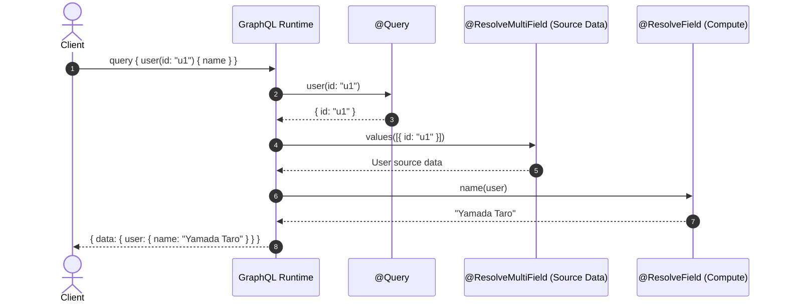
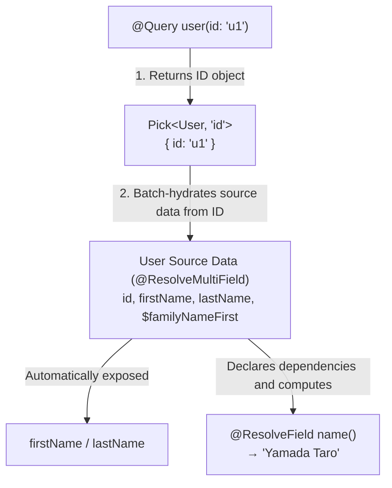
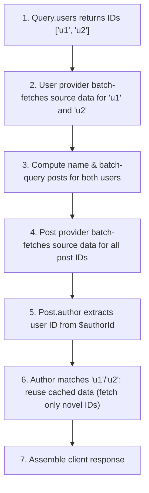

# GraphQL

Zelt's `@zeltjs/graphql` is a GraphQL framework supporting both **Code-first** (generating schemas from TypeScript types) and **Schema-first** (generating type-safe helpers from GraphQL SDL).

The examples use a project with these packages installed:

```bash
pnpm add @zeltjs/core @zeltjs/graphql @zeltjs/adapter-node @zeltjs/validator-valibot graphql valibot
pnpm add -D @zeltjs/cli typescript tsdown @rollup/plugin-swc @swc/core
```

## Mounting Endpoints {#entry-points}

Declare an endpoint using `graphql()`:

```ts
// @filename: models.ts
import type { ID } from '@zeltjs/graphql';

export type User = {
  readonly id: ID;
  readonly name: string;
};

// @filename: user.resolver.ts
import { args, Query, ResolveField, Resolver } from '@zeltjs/graphql';
import * as v from 'valibot';
import type { User } from './models';

export const GetUserInput = v.object({ id: v.string() });

@Resolver()
export class UserResolver {
  // 1. Query returns only the target ID
  @Query()
  user(input = args(GetUserInput)): Pick<User, 'id'> {
    return { id: input.id };
  }

  // 2. Receives parent ID and resolves the field value individually
  @ResolveField()
  name(parent: Pick<User, 'id'>): User['name'] {
    return `User ${parent.id}`;
  }
}

// @filename: app.ts
// ---cut---
import { createApp, http } from '@zeltjs/core';
import { graphql } from '@zeltjs/graphql';
import { UserResolver } from './user.resolver';

export const app = createApp([
  http({
    children: [
      graphql({
        path: '/graphql',
        resolvers: [UserResolver],
      }),
    ],
  }),
]);
```

---

## Code-first {#code-first}

In Zelt's Code-first, **`@Query` must only return target IDs (`Pick<Model, 'id'>`)**. From this foundation, target selection and field resolution progress step by step.

The model type declares public fields and private properties used during resolution. The GraphQL type consists of the TypeScript model properties excluding keys starting with `$`. `@ResolveField` and `@Relation` define how declared model fields are resolved.

### Level 1: Minimal Configuration (`@Query` and `@ResolveField`)

The most fundamental configuration combines `@Query` (which selects target IDs at the root) and `@ResolveField` (which resolves individual field values from that ID).

First, define the model type with a required `id: ID` identity:

```ts
import type { ID } from '@zeltjs/graphql';

export type User = {
  readonly id: ID;
  readonly name: string;
};
```

`ID` is a string-compatible type exported by `@zeltjs/graphql` that explicitly maps to GraphQL `ID!`. A `string` maps to `String!`, even when the property is named `id`.

In the resolver, `@Query` returns the target ID, and `@ResolveField` receives the parent ID to produce the field value:

```ts
// @filename: models.ts
import type { ID } from '@zeltjs/graphql';

export type User = {
  readonly id: ID;
  readonly name: string;
};

// @filename: user.resolver.ts
// ---cut---
import { args, Query, ResolveField, Resolver } from '@zeltjs/graphql';
import * as v from 'valibot';
import type { User } from './models';

export const GetUserInput = v.object({ id: v.string() });

@Resolver()
export class UserResolver {
  // 1. Query returns only the target ID
  @Query()
  user(input = args(GetUserInput)): Pick<User, 'id'> {
    return { id: input.id };
  }

  // 2. Receives parent ID and resolves the field value individually
  @ResolveField()
  name(parent: Pick<User, 'id'>): User['name'] {
    return `User ${parent.id}`;
  }
}
```

This resolver generates the following GraphQL schema:

```graphql
type Query {
  user(id: String!): User!
}

type User {
  id: ID!
  name: String!
}
```

---

### Level 2: Consolidating Multiple Fields (`@ResolveMultiField`)

Use `@ResolveMultiField` to resolve several properties together. Its return type `Pick<User, ...>` declares which properties it supplies; `name` is resolved separately by `@ResolveField`.

**`@ResolveMultiField`** solves this by hydrating model source data for batched IDs in a single operation.

#### 1. Expanding the Model and Private Properties (`$`)

Add properties to the model. Properties prefixed with `$` are **private to GraphQL** and are reserved for internal computations or relation IDs:

```ts
import type { ID } from '@zeltjs/graphql';

export type User = {
  readonly id: ID;
  readonly name: string;
  readonly firstName: string;
  readonly lastName: string;
  readonly $familyNameFirst: boolean;
};
```

#### 2. Batched Source Hydration with `@ResolveMultiField`

`@ResolveMultiField` receives an array of IDs and supplies model source data all at once:

```ts
// @filename: models.ts
import type { ID } from '@zeltjs/graphql';

export type User = {
  readonly id: ID;
  readonly name: string;
  readonly firstName: string;
  readonly lastName: string;
  readonly $familyNameFirst: boolean;
};

// @filename: user.resolver.ts
// ---cut---
import {
  args, Query, ResolveField, ResolveMultiField, Resolver,
} from '@zeltjs/graphql';
import * as v from 'valibot';
import type { User } from './models';

export const GetUserInput = v.object({ id: v.string() });
export const GetUsersInput = v.object({ ids: v.array(v.string()) });

const USERS_STORE = new Map<string, Pick<User, 'id' | 'firstName' | 'lastName' | '$familyNameFirst'>>([
  ['u1', { id: 'u1', firstName: 'Taro', lastName: 'Yamada', $familyNameFirst: true }],
  ['u2', { id: 'u2', firstName: 'John', lastName: 'Doe', $familyNameFirst: false }],
]);

@Resolver()
export class UserResolver {
  @Query()
  user(input = args(GetUserInput)): Pick<User, 'id'> {
    return { id: input.id };
  }

  @Query()
  users(input = args(GetUsersInput)): readonly Pick<User, 'id'>[] {
    return input.ids.map(id => ({ id }));
  }

  // Receives an array of IDs and supplies source data in a single batch
  @ResolveMultiField()
  values(
    refs: readonly Pick<User, 'id'>[],
  ): ReadonlyMap<User['id'], Pick<User, 'id' | 'firstName' | 'lastName' | '$familyNameFirst'> | null> {
    return new Map(refs.map(ref => [ref.id, USERS_STORE.get(ref.id) ?? null]));
  }

  // Computes derived fields from source data
  @ResolveField()
  name(
    user: Pick<User, 'firstName' | 'lastName' | '$familyNameFirst'>,
  ): User['name'] {
    return user.$familyNameFirst
      ? `${user.lastName} ${user.firstName}`
      : `${user.firstName} ${user.lastName}`;
  }
}
```

Key benefits:
- **Automatic Field Exposure**: Model properties that do not start with `$` (`firstName`, `lastName`) are exposed as public GraphQL fields automatically.
- **Dedicated Computed Fields**: `@ResolveField` is now used purely for fields derived from source data (`name`). Specifying `Pick<User, ...>` declares exact dependencies on required properties.

#### Resolution Lifecycle and Dependency Graph





---

### Level 3: Connecting Models (`@Relation`)

To connect references between different models (e.g., `User` and `Post`), use **`@Relation`**.

#### 1. Defining the Related Model

```ts
// @filename: user.ts
import type { ID } from '@zeltjs/graphql';

export type User = {
  readonly id: ID;
  readonly name: string;
  readonly firstName: string;
  readonly lastName: string;
  readonly $familyNameFirst: boolean;
};

// @filename: post.ts
// ---cut---
import type { User } from './user';
import type { ID } from '@zeltjs/graphql';

export type Post = {
  readonly id: ID;
  readonly title: string;
  readonly author: User;
  readonly $authorId: User['id'];
};
```

#### 2. Returning Related Model IDs with `@Relation`

Relation methods take parent properties (`$authorId` or `id`) and return **IDs of the related model**:

```ts
// @filename: models.ts
import type { ID } from '@zeltjs/graphql';

export type User = {
  readonly id: ID;
  readonly name: string;
  readonly posts: readonly Post[];
  readonly firstName: string;
  readonly lastName: string;
  readonly $familyNameFirst: boolean;
};

export type Post = {
  readonly id: ID;
  readonly title: string;
  readonly author: User;
  readonly $authorId: User['id'];
};

// @filename: post.resolver.ts
// ---cut---
import { Relation, ResolveMultiField, Resolver } from '@zeltjs/graphql';
import type { Post, User } from './models';

export const POSTS = new Map<string, Pick<Post, 'id' | 'title' | '$authorId'>>([
  ['p1', { id: 'p1', title: 'Hello', $authorId: 'u1' }],
]);

@Resolver()
export class PostResolver {
  @ResolveMultiField()
  values(
    ids: readonly Pick<Post, 'id'>[],
  ): ReadonlyMap<Post['id'], Pick<Post, 'id' | 'title' | '$authorId'> | null> {
    return new Map(ids.map(({ id }) => [id, POSTS.get(id) ?? null]));
  }

  @Relation()
  author(post: Pick<Post, '$authorId'>): Pick<User, 'id'> {
    return { id: post.$authorId };
  }
}
```

Declare `readonly posts: readonly Post[]` in `User`, and add this method to `UserResolver`:

```ts
// @filename: models.ts
import type { ID } from '@zeltjs/graphql';

export type User = {
  readonly id: ID;
  readonly name: string;
  readonly posts: readonly Post[];
  readonly firstName: string;
  readonly lastName: string;
  readonly $familyNameFirst: boolean;
};

export type Post = {
  readonly id: ID;
  readonly title: string;
  readonly author: User;
  readonly $authorId: User['id'];
};

// @filename: post.resolver.ts
import { Relation, ResolveMultiField, Resolver } from '@zeltjs/graphql';
import type { Post, User } from './models';

export const POSTS = new Map<string, Pick<Post, 'id' | 'title' | '$authorId'>>([
  ['p1', { id: 'p1', title: 'Hello', $authorId: 'u1' }],
]);

@Resolver()
export class PostResolver {
  @ResolveMultiField()
  values(
    ids: readonly Pick<Post, 'id'>[],
  ): ReadonlyMap<Post['id'], Pick<Post, 'id' | 'title' | '$authorId'> | null> {
    return new Map(ids.map(({ id }) => [id, POSTS.get(id) ?? null]));
  }

  @Relation()
  author(post: Pick<Post, '$authorId'>): Pick<User, 'id'> {
    return { id: post.$authorId };
  }
}

// @filename: user.resolver.ts
import type { Post } from './models';
import { Relation } from '@zeltjs/graphql';
import { POSTS } from './post.resolver';
import {
  args, Query, ResolveField, ResolveMultiField, Resolver,
} from '@zeltjs/graphql';
import * as v from 'valibot';
import type { User } from './models';

export const GetUserInput = v.object({ id: v.string() });
export const GetUsersInput = v.object({ ids: v.array(v.string()) });

const USERS_STORE = new Map<string, Pick<User, 'id' | 'firstName' | 'lastName' | '$familyNameFirst'>>([
  ['u1', { id: 'u1', firstName: 'Taro', lastName: 'Yamada', $familyNameFirst: true }],
  ['u2', { id: 'u2', firstName: 'John', lastName: 'Doe', $familyNameFirst: false }],
]);

@Resolver()
export class UserResolver {
  @Query()
  user(input = args(GetUserInput)): Pick<User, 'id'> {
    return { id: input.id };
  }

  @Query()
  users(input = args(GetUsersInput)): readonly Pick<User, 'id'>[] {
    return input.ids.map(id => ({ id }));
  }

  // Receives an array of IDs and supplies source data in a single batch
  @ResolveMultiField()
  values(
    refs: readonly Pick<User, 'id'>[],
  ): ReadonlyMap<User['id'], Pick<User, 'id' | 'firstName' | 'lastName' | '$familyNameFirst'> | null> {
    return new Map(refs.map(ref => [ref.id, USERS_STORE.get(ref.id) ?? null]));
  }

  // Computes derived fields from source data
  @ResolveField()
  name(
    user: Pick<User, 'firstName' | 'lastName' | '$familyNameFirst'>,
  ): User['name'] {
    return user.$familyNameFirst
      ? `${user.lastName} ${user.firstName}`
      : `${user.firstName} ${user.lastName}`;
  }

// ---cut---
  @Relation()
  posts(
    parents: readonly Pick<User, 'id'>[],
  ): ReadonlyMap<User['id'], readonly Pick<Post, 'id'>[]> {
    return new Map(parents.map(parent => [
      parent.id,
      [...POSTS.values()]
        .filter(post => post.$authorId === parent.id)
        .map(post => ({ id: post.id })),
    ]));
  }
// ---cut-after---
}
```

Register both resolvers in the endpoint. Update `src/app.ts` as follows:

```ts
// @filename: src/models.ts
import type { ID } from '@zeltjs/graphql';

export type User = {
  readonly id: ID;
  readonly name: string;
  readonly posts: readonly Post[];
  readonly firstName: string;
  readonly lastName: string;
  readonly $familyNameFirst: boolean;
};

export type Post = {
  readonly id: ID;
  readonly title: string;
  readonly author: User;
  readonly $authorId: User['id'];
};

// @filename: src/post.resolver.ts
import { Relation, ResolveMultiField, Resolver } from '@zeltjs/graphql';
import type { Post, User } from './models';

export const POSTS = new Map<string, Pick<Post, 'id' | 'title' | '$authorId'>>([
  ['p1', { id: 'p1', title: 'Hello', $authorId: 'u1' }],
]);

@Resolver()
export class PostResolver {
  @ResolveMultiField()
  values(
    ids: readonly Pick<Post, 'id'>[],
  ): ReadonlyMap<Post['id'], Pick<Post, 'id' | 'title' | '$authorId'> | null> {
    return new Map(ids.map(({ id }) => [id, POSTS.get(id) ?? null]));
  }

  @Relation()
  author(post: Pick<Post, '$authorId'>): Pick<User, 'id'> {
    return { id: post.$authorId };
  }
}

// @filename: src/user.resolver.ts
import type { Post } from './models';
import { Relation } from '@zeltjs/graphql';
import { POSTS } from './post.resolver';
import {
  args, Query, ResolveField, ResolveMultiField, Resolver,
} from '@zeltjs/graphql';
import * as v from 'valibot';
import type { User } from './models';

export const GetUserInput = v.object({ id: v.string() });
export const GetUsersInput = v.object({ ids: v.array(v.string()) });

const USERS_STORE = new Map<string, Pick<User, 'id' | 'firstName' | 'lastName' | '$familyNameFirst'>>([
  ['u1', { id: 'u1', firstName: 'Taro', lastName: 'Yamada', $familyNameFirst: true }],
  ['u2', { id: 'u2', firstName: 'John', lastName: 'Doe', $familyNameFirst: false }],
]);

@Resolver()
export class UserResolver {
  @Query()
  user(input = args(GetUserInput)): Pick<User, 'id'> {
    return { id: input.id };
  }

  @Query()
  users(input = args(GetUsersInput)): readonly Pick<User, 'id'>[] {
    return input.ids.map(id => ({ id }));
  }

  // Receives an array of IDs and supplies source data in a single batch
  @ResolveMultiField()
  values(
    refs: readonly Pick<User, 'id'>[],
  ): ReadonlyMap<User['id'], Pick<User, 'id' | 'firstName' | 'lastName' | '$familyNameFirst'> | null> {
    return new Map(refs.map(ref => [ref.id, USERS_STORE.get(ref.id) ?? null]));
  }

  // Computes derived fields from source data
  @ResolveField()
  name(
    user: Pick<User, 'firstName' | 'lastName' | '$familyNameFirst'>,
  ): User['name'] {
    return user.$familyNameFirst
      ? `${user.lastName} ${user.firstName}`
      : `${user.firstName} ${user.lastName}`;
  }

  @Relation()
  posts(
    parents: readonly Pick<User, 'id'>[],
  ): ReadonlyMap<User['id'], readonly Pick<Post, 'id'>[]> {
    return new Map(parents.map(parent => [
      parent.id,
      [...POSTS.values()]
        .filter(post => post.$authorId === parent.id)
        .map(post => ({ id: post.id })),
    ]));
  }
}

// @filename: src/app.ts
// ---cut---
import { createApp, http } from '@zeltjs/core';
import { graphql } from '@zeltjs/graphql';
import { UserResolver } from './user.resolver';
import { PostResolver } from './post.resolver';

export const app = createApp([
  http({ children: [
    graphql({ path: '/graphql', resolvers: [UserResolver, PostResolver] }),
  ] }),
]);
```

#### Nested Query Execution and Cached Reuse

```graphql
query {
  users(ids: ["u1", "u2"]) {
    name
    posts {
      title
      author {
        name
      }
    }
  }
}
```



Relations return target model IDs. A batch `@ResolveMultiField` can supply properties for multiple IDs together, without manual DataLoader management.

---

## Invocation Modes: Single and Batch {#invocation-modes}

`ResolveMultiField`, `Relation`, and `ResolveField` share a consistent calling convention. **Whether the parent parameter is an array** determines single vs. batch execution:

| Mode | Parent Parameter | Return Type | Invocation Behavior |
| --- | --- | --- | --- |
| **Single** | `Pick<Model, ...>` | `Result` / `Promise<Result>` | Called once per parent instance |
| **Batch** | `readonly Pick<Model, ...>[]` | `ReadonlyMap<ID, Result>` / `Promise<...>` | Called once with an array of all parent instances |

No extra decorator options are required.

```ts
// @filename: models.ts
import type { ID } from '@zeltjs/graphql';

export type User = {
  readonly id: ID;
  readonly name: string;
  readonly firstName: string;
  readonly lastName: string;
  readonly $familyNameFirst: boolean;
};

// @filename: user.resolver.ts
import {
  args, Query, ResolveField, ResolveMultiField, Resolver,
} from '@zeltjs/graphql';
import * as v from 'valibot';
import type { User } from './models';

export const GetUserInput = v.object({ id: v.string() });
export const GetUsersInput = v.object({ ids: v.array(v.string()) });

const USERS_STORE = new Map<string, Pick<User, 'id' | 'firstName' | 'lastName' | '$familyNameFirst'>>([
  ['u1', { id: 'u1', firstName: 'Taro', lastName: 'Yamada', $familyNameFirst: true }],
  ['u2', { id: 'u2', firstName: 'John', lastName: 'Doe', $familyNameFirst: false }],
]);

@Resolver()
export class UserResolver {
  @Query()
  user(input = args(GetUserInput)): Pick<User, 'id'> {
    return { id: input.id };
  }

  @Query()
  users(input = args(GetUsersInput)): readonly Pick<User, 'id'>[] {
    return input.ids.map(id => ({ id }));
  }

  // Receives an array of IDs and supplies source data in a single batch
// ---cut---
@ResolveMultiField()
values(
  user: Pick<User, 'id'>,
): Pick<User, 'id' | 'firstName' | 'lastName' | '$familyNameFirst'> | null {
  return USERS_STORE.get(user.id) ?? null;
}
// ---cut-after---
  // Computes derived fields from source data
  @ResolveField()
  name(
    user: Pick<User, 'firstName' | 'lastName' | '$familyNameFirst'>,
  ): User['name'] {
    return user.$familyNameFirst
      ? `${user.lastName} ${user.firstName}`
      : `${user.firstName} ${user.lastName}`;
  }
}
```

Single-item mode deduplicates identical IDs within an operation, but distinct IDs trigger separate calls. When values for multiple IDs can be fetched together, the array-based batch mode is recommended.

---

## Runtime Rules, Caching, and Contracts {#runtime-contract}

- **Model declarations and resolution**: Declare public fields in the model type. Each property is supplied by `@ResolveMultiField` or resolved by a corresponding `@ResolveField` or `@Relation`. Undeclared fields, missing or duplicate resolutions, and mismatched declared and returned types are build errors. `@ResolveMultiField` is unnecessary when fields can be resolved using only the ID.
- **ID Objects**: Query and Relation methods return objects containing IDs (`Pick<Model, 'id'>`), e.g. `{ id: input.id }`.
- **Deduplication**: Batch methods receive deduplicated arrays of IDs.
- **Map Integrity**: Return `ReadonlyMap` must include every input ID as a key. Each value must follow the declared result type: use `null` for a missing supplied model, and an empty array when a non-null list relation has no targets.
- **Cache Scope**: Hydrated model data is **scoped strictly to a single GraphQL operation**.
- **Error Handling**: Failures propagate as GraphQL errors according to schema nullability.

---

## Schema-First {#schema-first}

When starting from GraphQL SDL, use Schema-First mode:

```graphql
type Query {
  product(id: ID!): Product
}

type Product {
  id: ID!
  name: String!
}
```

```bash
zelt graphql codegen --schema src/graphql/schema.graphql --out src/generated/graphql.ts
```

`zelt build` also generates Schema-first resolver-checks files, but does not run TypeScript type checking. After generation, include those files in `tsconfig.json` and run `tsc --noEmit` to validate the resolvers against the SDL.

This generates the typed helper `Gql` and the `schema` export:

```ts
// @filename: src/generated/graphql.ts
import type { StandardSchemaV1 } from '@zeltjs/graphql';
import { readGraphqlArgs, validateGraphqlArgs } from '@zeltjs/graphql';

export const schema = { sdl: "type Query { product(id: ID!): Product }\ntype Product { id: ID!, name: String! }" } as const;

export namespace Gql {
  export namespace Query {
    export namespace product {
      export type Args = {
    readonly id: string;
  };
      export type Result = Gql.Product | null;
      export function args(): Args;
      export function args<Schema extends StandardSchemaV1<unknown, Args>>(
        schema: Schema,
      ): StandardSchemaV1.InferOutput<Schema>;
      export function args(schema?: StandardSchemaV1): Args {
        return schema ? (validateGraphqlArgs(schema) as Args) : readGraphqlArgs<Args>();
      }
    }
  }
  export type Product = {
    readonly id: string;
    readonly name: string;
  };
}

// @filename: src/graphql/product.resolver.ts
// ---cut---
import { Query, Resolver } from '@zeltjs/graphql';
import { Gql } from '../generated/graphql';

@Resolver()
export class ProductResolver {
  @Query()
  product(input = Gql.Query.product.args()): Gql.Query.product.Result {
    return { id: input.id, name: 'Keyboard' };
  }
}
```

Mount `schema` in `graphql()`:

```ts
// @filename: src/generated/graphql.ts
import type { StandardSchemaV1 } from '@zeltjs/graphql';
import { readGraphqlArgs, validateGraphqlArgs } from '@zeltjs/graphql';

export const schema = { sdl: "type Query { product(id: ID!): Product }\ntype Product { id: ID!, name: String! }" } as const;

export namespace Gql {
  export namespace Query {
    export namespace product {
      export type Args = {
    readonly id: string;
  };
      export type Result = Gql.Product | null;
      export function args(): Args;
      export function args<Schema extends StandardSchemaV1<unknown, Args>>(
        schema: Schema,
      ): StandardSchemaV1.InferOutput<Schema>;
      export function args(schema?: StandardSchemaV1): Args {
        return schema ? (validateGraphqlArgs(schema) as Args) : readGraphqlArgs<Args>();
      }
    }
  }
  export type Product = {
    readonly id: string;
    readonly name: string;
  };
}

// @filename: src/graphql/product.resolver.ts
import { Query, Resolver } from '@zeltjs/graphql';
import { Gql } from '../generated/graphql';

@Resolver()
export class ProductResolver {
  @Query()
  product(input = Gql.Query.product.args()): Gql.Query.product.Result {
    return { id: input.id, name: 'Keyboard' };
  }
}

// @filename: src/app.ts
// ---cut---
import { createApp, http } from '@zeltjs/core';
import { graphql } from '@zeltjs/graphql';
import { schema } from './generated/graphql';
import { ProductResolver } from './graphql/product.resolver';

export const app = createApp([
  http({
    children: [
      graphql({
        path: '/graphql',
        resolvers: [ProductResolver],
        schema,
      }),
    ],
  }),
]);
```

---

## Build Flow and Configuration {#build-flow}

Register `graphqlPlugin()` in `zelt.config.ts`:

```ts
// @filename: models.ts
import type { ID } from '@zeltjs/graphql';

export type User = {
  readonly id: ID;
  readonly name: string;
};

// @filename: user.resolver.ts
import { args, Query, ResolveField, Resolver } from '@zeltjs/graphql';
import * as v from 'valibot';
import type { User } from './models';

export const GetUserInput = v.object({ id: v.string() });

@Resolver()
export class UserResolver {
  // 1. Query returns only the target ID
  @Query()
  user(input = args(GetUserInput)): Pick<User, 'id'> {
    return { id: input.id };
  }

  // 2. Receives parent ID and resolves the field value individually
  @ResolveField()
  name(parent: Pick<User, 'id'>): User['name'] {
    return `User ${parent.id}`;
  }
}

// @filename: src/app.ts
import { createApp, http } from '@zeltjs/core';
import { graphql } from '@zeltjs/graphql';
import { UserResolver } from '../user.resolver';

export const app = createApp([
  http({
    children: [
      graphql({
        path: '/graphql',
        resolvers: [UserResolver],
      }),
    ],
  }),
]);

// @filename: index.ts
// ---cut---
import { defineConfig } from '@zeltjs/cli';
import { graphqlPlugin } from '@zeltjs/graphql/codegen';
import { valibotAdapter } from '@zeltjs/validator-valibot/openapi';

export default defineConfig({
  app: () => import('./src/app').then((m) => m.app),
  plugins: [graphqlPlugin({ schemaAdapter: valibotAdapter })],
  build: { command: 'pnpm exec tsdown' },
  dev: { entry: './src/node.ts' },
});
```

Configure decorator transformation for the Node build in `tsdown.config.ts`:

```ts
import swc from '@rollup/plugin-swc';
import { defineConfig } from 'tsdown';

export default defineConfig({
  plugins: [swc({
    swc: {
      jsc: {
        parser: { syntax: 'typescript', decorators: true },
        transform: {
          legacyDecorator: false,
          decoratorMetadata: false,
          decoratorVersion: '2022-03',
        },
      },
    },
  })],
  entry: { node: 'src/node.ts' },
  outDir: 'dist',
  format: ['esm'],
  target: 'es2022',
  platform: 'node',
  fixedExtension: false,
  deps: { neverBundle: [/^@zeltjs\//] },
});
```

Running `zelt build` or `zelt dev` automatically analyzes schemas and emits precompiled artifacts to `.zelt/prebuilt.ts`.

In your platform entry file (`node.ts`, etc.), pass the generated `zeltPrebuilt` into the adapter:

```ts
// @filename: src/models.ts
import type { ID } from '@zeltjs/graphql';

export type User = {
  readonly id: ID;
  readonly name: string;
};

// @filename: src/user.resolver.ts
import { args, Query, ResolveField, Resolver } from '@zeltjs/graphql';
import * as v from 'valibot';
import type { User } from './models';

export const GetUserInput = v.object({ id: v.string() });

@Resolver()
export class UserResolver {
  // 1. Query returns only the target ID
  @Query()
  user(input = args(GetUserInput)): Pick<User, 'id'> {
    return { id: input.id };
  }

  // 2. Receives parent ID and resolves the field value individually
  @ResolveField()
  name(parent: Pick<User, 'id'>): User['name'] {
    return `User ${parent.id}`;
  }
}

// @filename: src/app.ts
import { createApp, http } from '@zeltjs/core';
import { graphql } from '@zeltjs/graphql';
import { UserResolver } from './user.resolver';

export const app = createApp([
  http({
    children: [
      graphql({
        path: '/graphql',
        resolvers: [UserResolver],
      }),
    ],
  }),
]);

// @filename: .zelt/prebuilt.d.ts
import type { ZeltPrebuilt } from '@zeltjs/core';
export declare const zeltPrebuilt: ZeltPrebuilt;
// @filename: src/node.ts
// ---cut---
import { onNode } from '@zeltjs/adapter-node';
import { app } from './app';
import { zeltPrebuilt } from '../.zelt/prebuilt';

const nodeApp = await onNode(app, { prebuilt: zeltPrebuilt });
```

---

## Scope and Prebuilt Verification {#current-limitations}

GraphQL requires a prebuilt module generated at build time. If prebuilt artifacts or endpoint entries are missing, startup throws immediately to fail fast.

- **Build Time (`zelt build` / `zelt dev`)**: TypeScript analysis engine inspects model types, providers, field dependencies, and relations to generate the manifest and SDL.
- **Runtime Startup**: Validates prebuilt entries, endpoint paths, resolver names, decorator types, and exposed field names. Type and relation nullability/list checks compare the prebuilt manifest with the SDL; startup does not re-analyze the resolver TypeScript types. Regenerate prebuilt output after type changes and deploy it with the application.

---

## HTTP Protocol Details {#http}

HTTP transport conforms to `graphql-http` and execution is powered by `graphql-js`:

- **Methods**: `GET` accepts queries; `POST` accepts queries and mutations.
- **Headers**: Supports `Content-Type: application/json` and `Accept: application/graphql-response+json`.
- **Status Codes**: When using `application/graphql-response+json`, syntax errors, validation errors, and variable errors return HTTP 400; execution results return HTTP 200.
