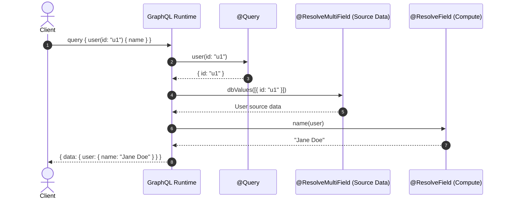
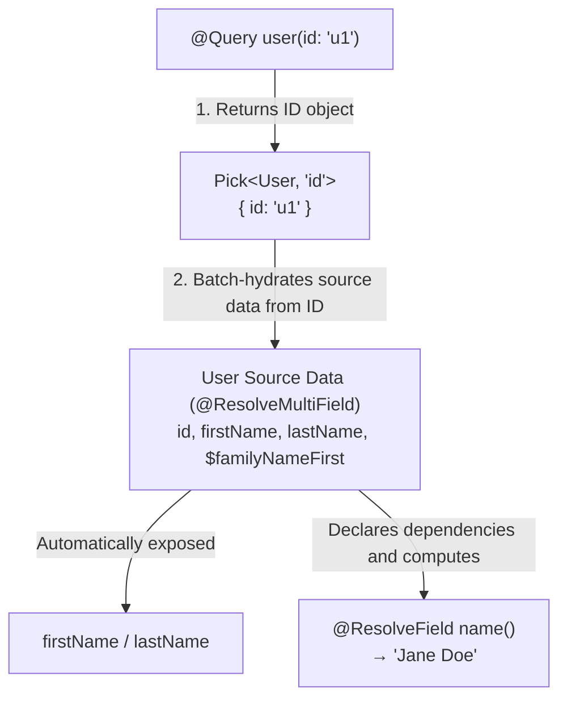
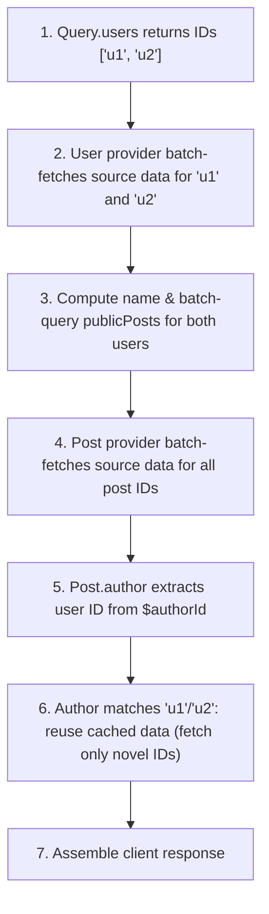

# GraphQL

Zelt's `@zeltjs/graphql` is a GraphQL framework supporting both **Code-first** (generating schemas from TypeScript types) and **Schema-first** (generating type-safe helpers from GraphQL SDL).

## Mounting Endpoints {#entry-points}

Declare an endpoint using `graphql()`:

```ts no-check
import { createApp, http } from '@zeltjs/core';
import { graphql } from '@zeltjs/graphql';
import { UserResolver } from './user.resolver';

export const app = createApp([
  http({
    children: [
      graphql({
        path: '/graphql',
        resolvers: [UserResolver],
      }),
    ],
  }),
]);
```

---

## Code-first {#code-first}

In Zelt's Code-first, **`@Query` must only return target IDs (`Pick<Model, 'id'>`)**. From this foundation, target selection and field resolution progress step by step.

### Level 1: Minimal Configuration (`@Query` and `@ResolveField`)

The most fundamental configuration combines `@Query` (which selects target IDs at the root) and `@ResolveField` (which resolves individual field values from that ID).

First, define the model type with a required `id: string` identity:

```ts no-check
export type User = {
  readonly id: string;
};
```

In the resolver, `@Query` returns the target ID, and `@ResolveField` receives the parent ID to produce the field value:

```ts no-check
import { args, Query, ResolveField, Resolver } from '@zeltjs/graphql';
import * as v from 'valibot';
import type { User } from './models';

export const GetUserInput = v.object({ id: v.string() });

@Resolver()
export class UserResolver {
  // 1. Query returns only the target ID
  @Query()
  user(input = args(GetUserInput)): Pick<User, 'id'> {
    return { id: input.id };
  }

  // 2. Receives parent ID and resolves the field value individually
  @ResolveField()
  name(parent: Pick<User, 'id'>): string {
    return `User ${parent.id}`;
  }
}
```

This resolver generates the following GraphQL schema:

```graphql
type Query {
  user(id: String!): User!
}

type User {
  id: ID!
  name: String!
}
```

---

### Level 2: Consolidating Multiple Fields (`@ResolveMultiField`)

Writing individual `@ResolveField` methods for every property and fetching data separately quickly leads to duplicate code and N+1 database queries.

**`@ResolveMultiField`** solves this by hydrating model source data for batched IDs in a single operation.

#### 1. Expanding the Model and Private Properties (`$`)

Add properties to the model. Properties prefixed with `$` are **private to GraphQL** and are reserved for internal computations or relation IDs:

```ts no-check
export type User = {
  readonly id: string;
  readonly firstName: string;
  readonly lastName: string;
  readonly $familyNameFirst: boolean;
};
```

#### 2. Batched Source Hydration with `@ResolveMultiField`

`@ResolveMultiField` receives an array of IDs and supplies model source data all at once:

```ts no-check
import {
  args, Query, ResolveField, ResolveMultiField, Resolver,
} from '@zeltjs/graphql';
import * as v from 'valibot';
import type { User } from './models';

export const GetUserInput = v.object({ id: v.string() });
export const GetUsersInput = v.object({ ids: v.array(v.string()) });

const USERS_STORE = new Map<string, User>([
  ['u1', { id: 'u1', firstName: 'Taro', lastName: 'Yamada', $familyNameFirst: true }],
  ['u2', { id: 'u2', firstName: 'John', lastName: 'Doe', $familyNameFirst: false }],
]);

@Resolver()
export class UserResolver {
  @Query()
  user(input = args(GetUserInput)): Pick<User, 'id'> {
    return { id: input.id };
  }

  @Query()
  users(input = args(GetUsersInput)): readonly Pick<User, 'id'>[] {
    return input.ids.map(id => ({ id }));
  }

  // Receives an array of IDs and supplies source data in a single batch
  @ResolveMultiField()
  dbValues(
    refs: readonly Pick<User, 'id'>[],
  ): ReadonlyMap<User['id'], User | null> {
    return new Map(refs.map(ref => [ref.id, USERS_STORE.get(ref.id) ?? null]));
  }

  // Computes derived fields from source data
  @ResolveField()
  name(
    user: Pick<User, 'firstName' | 'lastName' | '$familyNameFirst'>,
  ): string {
    return user.$familyNameFirst
      ? `${user.lastName} ${user.firstName}`
      : `${user.firstName} ${user.lastName}`;
  }
}
```

Key benefits:
- **Automatic Field Exposure**: Source properties supplied by `@ResolveMultiField` that do not start with `$` (`firstName`, `lastName`) are exposed as public GraphQL fields automatically.
- **Dedicated Computed Fields**: `@ResolveField` is now used purely for fields derived from source data (`name`). Specifying `Pick<User, ...>` declares exact dependencies on required properties.

#### Resolution Lifecycle and Dependency Graph





---

### Level 3: Connecting Models (`@Relation`)

To connect references between different models (e.g., `User` and `Post`), use **`@Relation`**.

#### 1. Defining the Related Model

```ts no-check
export type Post = {
  readonly id: string;
  readonly title: string;
  readonly $authorId: User['id'];
};
```

#### 2. Returning Related Model IDs with `@Relation`

Relation methods take parent properties (`$authorId` or `id`) and return **IDs of the related model**:

```ts no-check
import { inject } from '@zeltjs/core';
import { Relation, ResolveMultiField, Resolver } from '@zeltjs/graphql';
import { and, asc, eq, inArray } from 'drizzle-orm';
import { DrizzleService } from './db/drizzle.service';
import { posts } from './db/schema';
import type { Post, User } from './models';

@Resolver()
export class PostResolver {
  constructor(private db = inject(DrizzleService)) {}

  @ResolveMultiField()
  async dbValues(
    refs: readonly Pick<Post, 'id'>[],
  ): Promise<ReadonlyMap<Post['id'], Post | null>> {
    const rows = await this.db.client
      .select({
        id: posts.id,
        $authorId: posts.authorId,
        title: posts.title,
      })
      .from(posts)
      .where(inArray(posts.id, refs.map(ref => ref.id)));

    const byId = new Map(rows.map(row => [row.id, row]));
    return new Map(refs.map(ref => [ref.id, byId.get(ref.id) ?? null]));
  }

  // Returns the author's User ID from the parent post's $authorId
  @Relation()
  author(post: Pick<Post, '$authorId'>): Pick<User, 'id'> {
    return { id: post.$authorId };
  }
}
```

Similarly, add the inverse relation to `UserResolver`:

```ts no-check
  // Inside UserResolver: batch-queries published post IDs from parent user IDs
  @Relation()
  async publicPosts(
    parents: readonly Pick<User, 'id'>[],
  ): Promise<ReadonlyMap<User['id'], readonly Pick<Post, 'id'>[]>> {
    const rows = await this.db.client
      .select({ id: posts.id, authorId: posts.authorId })
      .from(posts)
      .where(and(
        inArray(posts.authorId, parents.map(parent => parent.id)),
        eq(posts.published, true),
      ))
      .orderBy(asc(posts.id));

    const byAuthor = new Map<User['id'], Pick<Post, 'id'>[]>(
      parents.map(parent => [parent.id, []]),
    );
    for (const row of rows) {
      byAuthor.get(row.authorId)?.push({ id: row.id });
    }
    return byAuthor;
  }
```

#### Nested Query Execution and Cached Reuse

```graphql
query {
  users(ids: ["u1", "u2"]) {
    name
    publicPosts {
      title
      author {
        name
      }
    }
  }
}
```



Relations simply return target model IDs, and actual data hydration is delegated to each model's `@ResolveMultiField`, eliminating N+1 issues without manual DataLoader plumbing.

---

## Invocation Modes: Single and Batch {#invocation-modes}

`ResolveMultiField`, `Relation`, and `ResolveField` share a consistent calling convention. **Whether the parent parameter is an array** determines single vs. batch execution:

| Mode | Parent Parameter | Return Type | Invocation Behavior |
| --- | --- | --- | --- |
| **Single** | `Pick<Model, ...>` | `Result` / `Promise<Result>` | Called once per parent instance |
| **Batch** | `readonly Pick<Model, ...>[]` | `ReadonlyMap<ID, Result>` / `Promise<...>` | Called once with an array of all parent instances |

No extra decorator options are required.

```ts no-check
// Single-item ResolveMultiField example
@ResolveMultiField()
async dbValues(ref: Pick<User, 'id'>): Promise<User | null> {
  const [row] = await this.db.client
    .select({ ... })
    .from(users)
    .where(eq(users.id, ref.id))
    .limit(1);

  return row ?? null;
}
```

Single-item mode deduplicates identical IDs within an operation, but distinct IDs trigger separate calls. For database operations, the array-based batch mode is recommended.

---

## Runtime Rules, Caching, and Contracts {#runtime-contract}

- **ID Objects**: Query and Relation methods return objects containing IDs (`Pick<Model, 'id'>`), e.g. `{ id: input.id }`.
- **Deduplication**: Batch methods receive deduplicated arrays of IDs.
- **Map Integrity**: Return `ReadonlyMap` must include every input ID as a key. Missing items should map to `null`.
- **Cache Scope**: Hydrated model data is **scoped strictly to a single GraphQL operation**.
- **Error Handling**: Failures propagate as GraphQL errors according to schema nullability.

---

## Schema-First {#schema-first}

When starting from GraphQL SDL, use Schema-First mode:

```graphql
type Query {
  product(id: ID!): Product
}

type Product {
  id: ID!
  name: String!
}
```

```bash
zelt graphql codegen --schema src/graphql/schema.graphql --out src/generated/graphql.ts
```

This generates the typed helper `Gql` and the `schema` export:

```ts no-check
import { Query, Resolver } from '@zeltjs/graphql';
import { Gql } from '../../generated/graphql';

@Resolver()
class ProductResolver {
  @Query()
  product(input = Gql.Query.product.args()): Gql.Query.product.Result {
    return { id: input.id, name: 'Keyboard' };
  }
}
```

Mount `schema` in `graphql()`:

```ts no-check
import { createApp, http } from '@zeltjs/core';
import { graphql } from '@zeltjs/graphql';
import { schema } from './generated/graphql';
import { ProductResolver } from './graphql/product.resolver';

export const app = createApp([
  http({
    children: [
      graphql({
        path: '/graphql',
        resolvers: [ProductResolver],
        schema,
      }),
    ],
  }),
]);
```

---

## Build Flow and Configuration {#build-flow}

Register `graphqlPlugin()` in `zelt.config.ts`:

```ts no-check
import { defineConfig } from '@zeltjs/cli';
import { graphqlPlugin } from '@zeltjs/graphql/codegen';

export default defineConfig({
  app: () => import('./src/app').then((m) => m.app),
  plugins: [graphqlPlugin()],
  build: { entry: './src/node.ts' },
  dev: { entry: './src/node.ts' },
});
```

Running `zelt build` or `zelt dev` automatically analyzes schemas and emits precompiled artifacts to `.zelt/prebuilt.ts`.

In your platform entry file (`node.ts`, etc.), pass the generated `zeltPrebuilt` into the adapter:

```ts no-check
import { onNode } from '@zeltjs/adapter-node';
import { app } from './app';
import { zeltPrebuilt } from '../.zelt/prebuilt';

const nodeApp = await onNode(app, { prebuilt: zeltPrebuilt });
```

---

## Scope and Prebuilt Verification {#current-limitations}

GraphQL requires a prebuilt module generated at build time. If prebuilt artifacts or endpoint entries are missing, startup throws immediately to fail fast.

- **Build Time (`zelt build` / `zelt dev`)**: TypeScript analysis engine inspects model types, providers, field dependencies, and relations to generate the manifest and SDL.
- **Runtime Startup**: Validates prebuilt entries, endpoint paths, resolver names, decorator types, exposed field names, source data types, and relation nullability/array consistency.

---

## HTTP Protocol Details {#http}

HTTP transport conforms to `graphql-http` and execution is powered by `graphql-js`:

- **Methods**: `GET` accepts queries; `POST` accepts queries and mutations.
- **Headers**: Supports `Content-Type: application/json` and `Accept: application/graphql-response+json`.
- **Status Codes**: When using `application/graphql-response+json`, syntax errors, validation errors, and variable errors return HTTP 400; execution results return HTTP 200.
