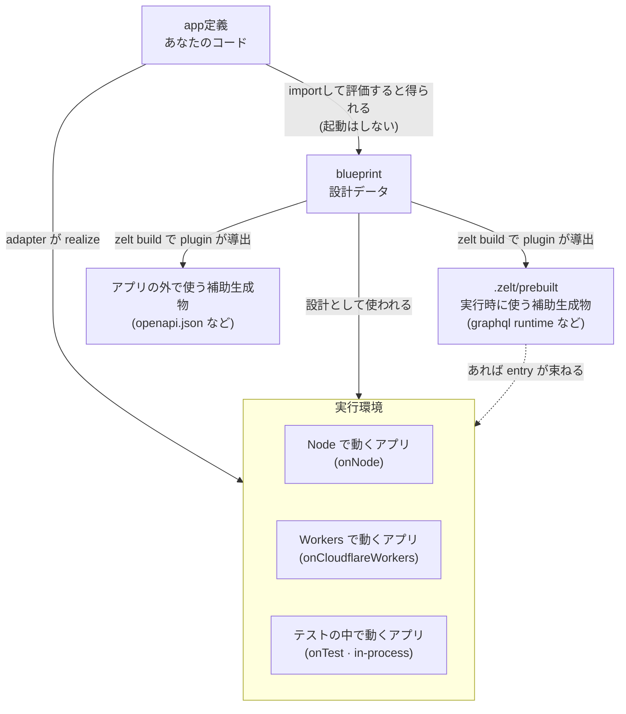
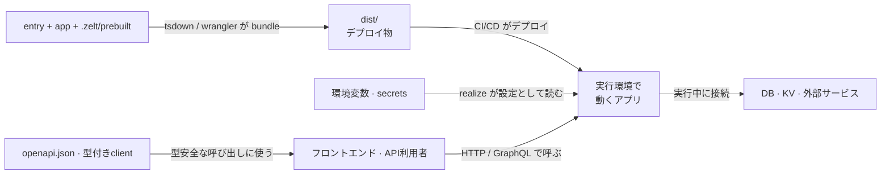

# 全体像

Zeltであなたが書くのはアプリの機能だけです。GraphQLスキーマ、OpenAPIドキュメント、型付きクライアント、起動に必要な構成は、すべてコードから導かれます。同じアプリが Node・Bun・Cloudflare Workers・Lambda に加えてテストでも、adapterひとつの差し替えでそのまま動きます。

次の図はコードから生成物を作り、各環境でアプリを動かすまでの関係を示しています。

## あなたが書くもの

- **app定義**は `createApp([...])` と、その中に置くfeature群です。HTTPコントローラ、GraphQLリゾルバ、コマンド、スケジューラ、それらを支えるserviceでアプリの機能を記述します。`.zelt/` からは何もimportせず、起動ロジックも持ちません。
- **entry**は `node.ts`、`worker.ts` など、プラットフォームごとに書く数行のコードです。appとprebuiltをimportしてadapterに渡します。アプリを起動するコードで `.zelt/` を参照するのは、このファイルだけです。
- **テスト**もentryと同じように、appとprebuiltをadapterのひとつである `onTest` に渡します。テスト用の別経路ではなく、本番と同じ経路をin-processで実行します。
- **zelt.config.ts**にはどのpluginを使うかと、build・devの設定を書きます。CLIはこの設定に従います。

## zelt CLI (build / dev)

`zelt build` はapp定義をimportして評価します。`zelt dev` も再起動のたびに同じ評価を行います。この評価ではデコレータと型メタデータを収集しますが、サーバーの起動や接続の開始は行いません。得られる **blueprint** はアプリのルート・リゾルバ・型を表すデータです。

pluginはblueprintから、GraphQLスキーマと実行可能runtime、OpenAPI文書、型付きクライアントを生成します。いずれも同じコードから導かれ、build時や起動時にコードとの整合性を検査します。検査する契約はfeatureごとに異なり、GraphQLのモデルモードでは供給元・依存・参照先・Queryの公開設定も含みます。検査範囲は [GraphQLの契約](./graphql.md#current-limitations)を参照してください。appから定義を削除すると、次のbuildで対応する生成物も削除されます。

pluginが必須になるのは、そのpluginに依存するfeatureを使う場合だけです。例えば `graphql()` エンドポイントには `graphqlPlugin()` と `zelt build` が必要です。

最後にNodeではtsdown、Workersではwranglerが、entryとその依存をbundleして `dist/` に出力します。

## 生成物

- **`.zelt/`** はアプリ自身から作る生成物です。アプリが自分自身の生成物に依存しないよう、importできるのはentryとテストだけにしています。削除しても `zelt build` で再生成できます。runtime群は一つの値モジュール `.zelt/prebuilt.ts` にまとめられます。
- **`openapi.json` / 型付きclient**はフロントエンドやAPI利用者向けの生成物です。コードから導かれるため、仕様書が実装と食い違うことはありません。
- **`dist/`** はentry・app・prebuiltをbundleしたデプロイ物です。これを実行環境へ配置します。

## 実行環境

adapterは同じ役割を持つ交換可能な実装です。appのコード、blueprintの設計データ、そして用意されていれば `.zelt/prebuilt` を受け取って、アプリを **realize** します。具体的にはDIを実行し、環境変数から設定を読み、DB・KV・外部サービスへの接続を開き、サーバーを起動します。

`onNode`、`onBun`、`onCloudflareWorkers`、`onLambda`、`onElectron`、`onTest` はこの役割を担います。プラットフォームを変更するときは、この呼び出しだけを差し替えます。ほかの構成を変える必要はありません。

デプロイと運用に関わる構成は、次のように接続されます。

起動時には、各featureが自身のprebuilt entryとコードの整合性を検査します。不一致があれば起動に失敗し、修正方法として `zelt build` を案内します。古い生成物を使ったまま、エラーを出さずに動作することはありません。
