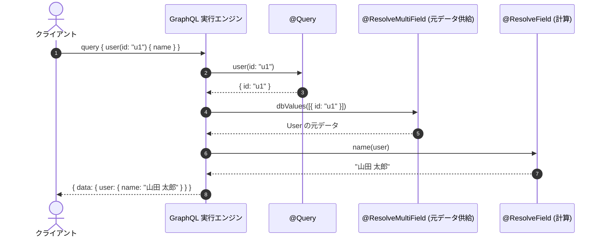
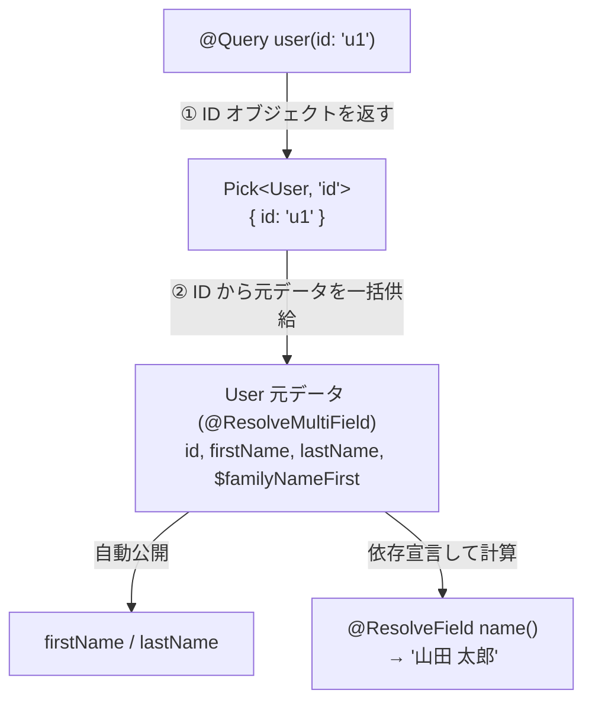
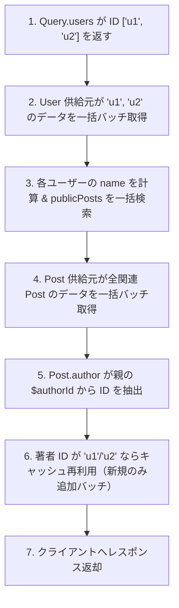

# GraphQL

Zelt の `@zeltjs/graphql` は、TypeScript の型からスキーマを生成する **Code-first**、および GraphQL SDL から型定義を生成する **Schema-first** の両方に対応した GraphQL フレームワークです。

## エンドポイントの作成 {#entry-points}

まずは `graphql()` を使ってエンドポイントを宣言します。

```ts no-check
import { createApp, http } from '@zeltjs/core';
import { graphql } from '@zeltjs/graphql';
import { UserResolver } from './user.resolver';

export const app = createApp([
  http({
    children: [
      graphql({
        path: '/graphql',
        resolvers: [UserResolver],
      }),
    ],
  }),
]);
```

---

## Code-first {#code-first}

Zelt の Code-first では、**`@Query` は対象の ID（`Pick<Model, 'id'>`）を返す** という原則に基づいています。ID の選定とフィールドの解決を段階的に組み立てていきます。

### Level 1: 最小構成（`@Query` と `@ResolveField`）

最もシンプルな構成は、ルートで対象の ID を選ぶ `@Query` と、その ID からフィールドの値を解決する `@ResolveField` の組み合わせです。

まず、モデルの型を定義します。識別子として `id: string` を持ちます。

```ts no-check
export type User = {
  readonly id: string;
};
```

リゾルバでは、`@Query` が対象の ID を返し、`@ResolveField` が親の ID を受け取ってフィールドの値を返します。

```ts no-check
import { args, Query, ResolveField, Resolver } from '@zeltjs/graphql';
import * as v from 'valibot';
import type { User } from './models';

export const GetUserInput = v.object({ id: v.string() });

@Resolver()
export class UserResolver {
  // ① Query は対象の ID のみを返す
  @Query()
  user(input = args(GetUserInput)): Pick<User, 'id'> {
    return { id: input.id };
  }

  // ② 親の ID を受け取って、フィールドの値を個別に解決する
  @ResolveField()
  name(parent: Pick<User, 'id'>): string {
    return `User ${parent.id}`;
  }
}
```

このリゾルバから、次の GraphQL スキーマが自動生成されます。

```graphql
type Query {
  user(id: String!): User!
}

type User {
  id: ID!
  name: String!
}
```

---

### Level 2: 複数フィールドの集約（`@ResolveMultiField`）

モデルのフィールドが増えるたびに `@ResolveField` を個別に書いて都度データを引くのは、コードの重複が増えるだけでなく、データベースアクセスが細分化して N+1 問題の原因になります。

そこで **`@ResolveMultiField`** を使って、ID からモデルの元データをまとめて一度に供給します。

#### 1. モデルの拡張と非公開プロパティ (`$`)

モデルにプロパティを追加します。プロパティ名が `$` で始まるものは **GraphQL 非公開** となり、計算用や内部参照用のデータとして保持できます。

```ts no-check
export type User = {
  readonly id: string;
  readonly firstName: string;
  readonly lastName: string;
  readonly $familyNameFirst: boolean;
};
```

#### 2. `@ResolveMultiField` による元データのバッチ取得

`@ResolveMultiField` を定義すると、複数の ID をまとめて受け取り、モデルの元データを一度に供給できます。

```ts no-check
import {
  args, Query, ResolveField, ResolveMultiField, Resolver,
} from '@zeltjs/graphql';
import * as v from 'valibot';
import type { User } from './models';

export const GetUserInput = v.object({ id: v.string() });
export const GetUsersInput = v.object({ ids: v.array(v.string()) });

const USERS_STORE = new Map<string, User>([
  ['u1', { id: 'u1', firstName: '太郎', lastName: '山田', $familyNameFirst: true }],
  ['u2', { id: 'u2', firstName: 'John', lastName: 'Doe', $familyNameFirst: false }],
]);

@Resolver()
export class UserResolver {
  @Query()
  user(input = args(GetUserInput)): Pick<User, 'id'> {
    return { id: input.id };
  }

  @Query()
  users(input = args(GetUsersInput)): readonly Pick<User, 'id'>[] {
    return input.ids.map(id => ({ id }));
  }

  // ID の配列を受け取り、モデルの元データを一括供給する（自動バッチ）
  @ResolveMultiField()
  dbValues(
    refs: readonly Pick<User, 'id'>[],
  ): ReadonlyMap<User['id'], User | null> {
    return new Map(refs.map(ref => [ref.id, USERS_STORE.get(ref.id) ?? null]));
  }

  // 元データをもとに計算フィールドを導出する
  @ResolveField()
  name(
    user: Pick<User, 'firstName' | 'lastName' | '$familyNameFirst'>,
  ): string {
    return user.$familyNameFirst
      ? `${user.lastName} ${user.firstName}`
      : `${user.firstName} ${user.lastName}`;
  }
}
```

ポイント：
- **公開プロパティの自動公開**: `@ResolveMultiField` で供給された元データのうち、`$` で始まらないプロパティ（`firstName`, `lastName`）は自動で GraphQL フィールドとして公開されます。
- **計算フィールドの特化**: `@ResolveField` は「元データから値を導出する計算フィールド（`name`）」にのみ専念できます。引数に `Pick<User, ...>` を指定することで、必要なプロパティへの依存を宣言します。

#### フィールド解決のライフサイクルと依存グラフ





---

### Level 3: モデル同士の接続（`@Relation`）

複数のモデル（例: `User` と `Post`）の間の参照をつなぐのが **`@Relation`** です。

#### 1. 関連先モデルの定義

```ts no-check
export type Post = {
  readonly id: string;
  readonly title: string;
  readonly $authorId: User['id'];
};
```

#### 2. `@Relation` で関連先モデルの ID を返す

リレーションメソッドは、親の持つデータ（`$authorId` や `id`）から、**関連先モデルの ID** を選んで返します。

```ts no-check
import { inject } from '@zeltjs/core';
import { Relation, ResolveMultiField, Resolver } from '@zeltjs/graphql';
import { and, asc, eq, inArray } from 'drizzle-orm';
import { DrizzleService } from './db/drizzle.service';
import { posts } from './db/schema';
import type { Post, User } from './models';

@Resolver()
export class PostResolver {
  constructor(private db = inject(DrizzleService)) {}

  @ResolveMultiField()
  async dbValues(
    refs: readonly Pick<Post, 'id'>[],
  ): Promise<ReadonlyMap<Post['id'], Post | null>> {
    const rows = await this.db.client
      .select({
        id: posts.id,
        $authorId: posts.authorId,
        title: posts.title,
      })
      .from(posts)
      .where(inArray(posts.id, refs.map(ref => ref.id)));

    const byId = new Map(rows.map(row => [row.id, row]));
    return new Map(refs.map(ref => [ref.id, byId.get(ref.id) ?? null]));
  }

  // 親 Post の $authorId から、著者の User ID を返す
  @Relation()
  author(post: Pick<Post, '$authorId'>): Pick<User, 'id'> {
    return { id: post.$authorId };
  }
}
```

同様に、`UserResolver` 側にも Post へのリレーションを追加できます。

```ts no-check
  // UserResolver 内: 親 User の ID 配列から、公開 Post の ID 一覧をバッチ検索して返す
  @Relation()
  async publicPosts(
    parents: readonly Pick<User, 'id'>[],
  ): Promise<ReadonlyMap<User['id'], readonly Pick<Post, 'id'>[]>> {
    const rows = await this.db.client
      .select({ id: posts.id, authorId: posts.authorId })
      .from(posts)
      .where(and(
        inArray(posts.authorId, parents.map(parent => parent.id)),
        eq(posts.published, true),
      ))
      .orderBy(asc(posts.id));

    const byAuthor = new Map<User['id'], Pick<Post, 'id'>[]>(
      parents.map(parent => [parent.id, []]),
    );
    for (const row of rows) {
      byAuthor.get(row.authorId)?.push({ id: row.id });
    }
    return byAuthor;
  }
```

#### ネストしたクエリの実行とキャッシュ再利用

```graphql
query {
  users(ids: ["u1", "u2"]) {
    name
    publicPosts {
      title
      author {
        name
      }
    }
  }
}
```



どれだけクエリが深くネストしても、リレーションは関連先モデルの ID を返し、データの実取得は各モデルの `@ResolveMultiField` に自動で束ねられるため、DataLoader を手動管理することなく N+1 問題が解消されます。

---

## 呼び出し形式（単体・バッチ） {#invocation-modes}

`ResolveMultiField`、`Relation`、`ResolveField` はすべて統一された規約に従います。**引数の型が配列かどうか** で自動的に単体実行かバッチ実行かが決まります。

| 形式 | 引数の型 | 戻り値の型 | 動作 |
| --- | --- | --- | --- |
| **単体形式** | `Pick<Model, ...>` | `Result` / `Promise<Result>` | 親 1 件ごとに呼び出される |
| **バッチ形式** | `readonly Pick<Model, ...>[]` | `ReadonlyMap<ID, Result>` / `Promise<...>` | 複数の親をまとめて 1 回呼び出される |

デコレータに追加のオプションを指定する必要はありません。

```ts no-check
// 単体形式の ResolveMultiField の例
@ResolveMultiField()
async dbValues(ref: Pick<User, 'id'>): Promise<User | null> {
  const [row] = await this.db.client
    .select({ ... })
    .from(users)
    .where(eq(users.id, ref.id))
    .limit(1);

  return row ?? null;
}
```

単体形式でも同一 operation 内で同じ ID が現れた場合はキャッシュが再利用されますが、未取得の ID は個別に呼び出されるため、DB アクセスを伴う場合は配列を受け取るバッチ形式を推奨します。

---

## 実行・キャッシュ・契約のルール {#runtime-contract}

- **ID オブジェクトの返却**: Query や Relation は、`{ id: input.id }` のように ID をプロパティに持つオブジェクト（`Pick<Model, 'id'>`）を返します。
- **入力の重複排除**: バッチ形式のメソッドには、重複のない ID 配列が渡されます。
- **Map の整合性**: バッチ形式の戻り値 `ReadonlyMap` は、入力されたすべての ID をキーとして含める必要があります。該当データが存在しない場合は値を `null` とします。
- **キャッシュのスコープ**: 取得データや存在確認の結果は **1 回の GraphQL operation 内でのみ共有** されます。別リクエストや別認可コンテキストへ漏洩することはありません。
- **エラーハンドリング**: 取得失敗や例外は自動でフォールバックされず、GraphQL エラーとして schema の nullability に従って上位へ伝播します。

---

## Schema-first {#schema-first}

既存の GraphQL スキーマ（SDL）を起点として開発する場合は、Schema-first モードを利用できます。

```graphql
type Query {
  product(id: ID!): Product
}

type Product {
  id: ID!
  name: String!
}
```

```bash
zelt graphql codegen --schema src/graphql/schema.graphql --out src/generated/graphql.ts
```

このコマンドにより、スキーマに対応する型付きヘルパー `Gql` と `schema` export が生成されます。

```ts no-check
import { Query, Resolver } from '@zeltjs/graphql';
import { Gql } from '../../generated/graphql';

@Resolver()
class ProductResolver {
  @Query()
  product(input = Gql.Query.product.args()): Gql.Query.product.Result {
    return { id: input.id, name: 'Keyboard' };
  }
}
```

生成された `schema` を `graphql()` に渡してマウントします。

```ts no-check
import { createApp, http } from '@zeltjs/core';
import { graphql } from '@zeltjs/graphql';
import { schema } from './generated/graphql';
import { ProductResolver } from './graphql/product.resolver';

export const app = createApp([
  http({
    children: [
      graphql({
        path: '/graphql',
        resolvers: [ProductResolver],
        schema,
      }),
    ],
  }),
]);
```

---

## Build flow と設定 {#build-flow}

`zelt.config.ts` に `graphqlPlugin()` を登録します。

```ts no-check
import { defineConfig } from '@zeltjs/cli';
import { graphqlPlugin } from '@zeltjs/graphql/codegen';

export default defineConfig({
  app: () => import('./src/app').then((m) => m.app),
  plugins: [graphqlPlugin()],
  build: { entry: './src/node.ts' },
  dev: { entry: './src/node.ts' },
});
```

`zelt build` または `zelt dev` を実行すると、プラグインがスキーマ解析と `.zelt/prebuilt.ts` への事前コンパイルを自動で行います。

プラットフォームのエントリファイル（`node.ts` 等）では、生成された `zeltPrebuilt` をアダプターに渡します。

```ts no-check
import { onNode } from '@zeltjs/adapter-node';
import { app } from './app';
import { zeltPrebuilt } from '../.zelt/prebuilt';

const nodeApp = await onNode(app, { prebuilt: zeltPrebuilt });
```

---

## 契約範囲と整合性検査 {#current-limitations}

GraphQL 機能の動作にはビルド時に生成された prebuilt モジュールが必要です。モジュールやエンドポイントの prebuilt entry が欠落している場合、起動時にエラーをスローしてフェイルファストします。

検査の役割はビルド時と起動時で明確に分かれています：

- **ビルド時 (`zelt build` / `zelt dev`)**:
  TypeScript の解析エンジンがモデルの型・供給元・依存関係・リレーションを解析し、最新の manifest と SDL を生成します。
- **起動時**:
  prebuilt entry の存在、エンドポイントの path、リゾルバ名、デコレータの種類、公開フィールド名、元データの型やリレーションの nullability / 配列の一致を検証します。

---

## HTTP 仕様の扱い {#http}

HTTP レベルの処理は `graphql-http`、実行は `graphql-js` に準拠しています。

- **メソッド**: `GET` は Query のみ、`POST` は Query と Mutation を受け付けます。
- **ヘッダー**: `POST` 時の `Content-Type: application/json` をサポートし、`Accept: application/graphql-response+json` に対応しています。
- **ステータスコード**: `application/graphql-response+json` 利用時、構文エラー・検証エラー・変数エラーは HTTP 400、実行結果は HTTP 200 となります。
