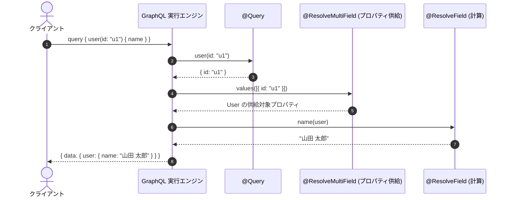
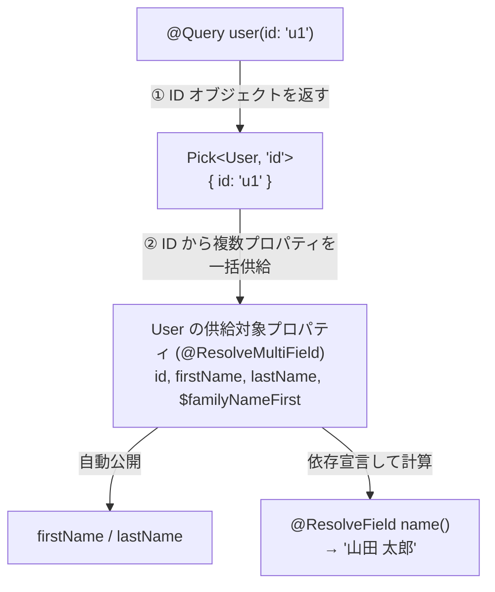
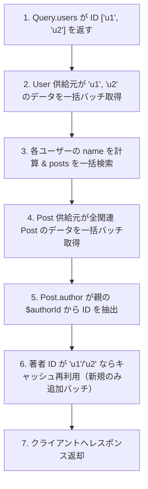

# GraphQL

Zelt の `@zeltjs/graphql` は、TypeScript の型からスキーマを生成する **Code-first**、および GraphQL SDL から型定義を生成する **Schema-first** の両方に対応した GraphQL フレームワークです。

この例では、次のパッケージをインストールしたプロジェクトを使います。

```bash
pnpm add @zeltjs/core @zeltjs/graphql @zeltjs/adapter-node @zeltjs/validator-valibot graphql valibot
pnpm add -D @zeltjs/cli typescript tsdown @rollup/plugin-swc @swc/core
```

## エンドポイントの作成 {#entry-points}

まずは `graphql()` を使ってエンドポイントを宣言します。

```ts
// @filename: models.ts
import type { ID } from '@zeltjs/graphql';

export type User = {
  readonly id: ID;
  readonly name: string;
};

// @filename: user.resolver.ts
import { args, Query, ResolveField, Resolver } from '@zeltjs/graphql';
import * as v from 'valibot';
import type { User } from './models';

export const GetUserInput = v.object({ id: v.string() });

@Resolver()
export class UserResolver {
  // ① Query は対象の ID のみを返す
  @Query()
  user(input = args(GetUserInput)): Pick<User, 'id'> {
    return { id: input.id };
  }

  // ② 親の ID を受け取って、フィールドの値を個別に解決する
  @ResolveField()
  name(parent: Pick<User, 'id'>): User['name'] {
    return `User ${parent.id}`;
  }
}

// @filename: app.ts
// ---cut---
import { createApp, http } from '@zeltjs/core';
import { graphql } from '@zeltjs/graphql';
import { UserResolver } from './user.resolver';

export const app = createApp([
  http({
    children: [
      graphql({
        path: '/graphql',
        resolvers: [UserResolver],
      }),
    ],
  }),
]);
```

---

## Code-first {#code-first}

Zelt の GraphQL では、IDの選定とフィールドの解決を明確に分けています。
**`@Query` は対象の ID（`Pick<Model, 'id'>`）を返し、`@ResolveField` はその ID からフィールドの値を解決する** という原則に基づいています。

- Model 型を宣言
- `@Query` でModelの ID / ID List を返す
- `@ResolveField` で ID から実データを解決して返す

が基本の流れとなります


### Level 1: 最小構成（`@Query` と `@ResolveField`）

最もシンプルな構成は、ルートで対象の ID を選ぶ `@Query` と、その ID からフィールドの値を解決する `@ResolveField` の組み合わせです。

まず、モデルの型を定義します。識別子として `id: ID` を持ちます。

```ts
import type { ID } from '@zeltjs/graphql';

export type User = {
  readonly id: ID;
  readonly name: string;
};
```

`ID` は `@zeltjs/graphql` が提供する文字列互換の型で、GraphQL の `ID!` を明示します。`string` は `String!` になります。

リゾルバでは、`@Query` が対象の ID を返し、`@ResolveField` が親の ID を受け取ってフィールドの値を返します。

```ts
// @filename: models.ts
import type { ID } from '@zeltjs/graphql';

export type User = {
  readonly id: ID;
  readonly name: string;
};

// @filename: user.resolver.ts
// ---cut---
import { args, Query, ResolveField, Resolver } from '@zeltjs/graphql';
import * as v from 'valibot';
import type { User } from './models';

export const GetUserInput = v.object({ id: v.string() });

@Resolver()
export class UserResolver {
  // ① Query は対象の ID のみを返す
  @Query()
  user(input = args(GetUserInput)): Pick<User, 'id'> {
    return { id: input.id };
  }

  // ② 親の ID を受け取って、フィールドの値を個別に解決する
  @ResolveField()
  name(parent: Pick<User, 'id'>): User['name'] {
    return `User ${parent.id}`;
  }
}
```

このリゾルバから、次の GraphQL スキーマが自動生成されます。

```graphql
type Query {
  user(id: String!): User!
}

type User {
  id: ID!
  name: String!
}
```

---

### Level 2: 複数フィールドの集約（`@ResolveMultiField`）

複数のフィールドをまとめて解決する場合は、`@ResolveMultiField` を使います。戻り値の `Pick<User, ...>` で担当するプロパティを宣言し、`name` は `@ResolveField` で解決します。

そこで **`@ResolveMultiField`** を使って、ID から複数プロパティの値をまとめて一度に供給します。

#### 1. モデルの拡張と非公開プロパティ (`$`)

モデルにプロパティを追加します。プロパティ名が `$` で始まるものは **GraphQL 非公開** となり、計算用や内部参照用のデータとして保持できます。

```ts
import type { ID } from '@zeltjs/graphql';

export type User = {
  readonly id: ID;
  readonly name: string;
  readonly firstName: string;
  readonly lastName: string;
  readonly $familyNameFirst: boolean;
};
```

#### 2. `@ResolveMultiField` によるプロパティの一括解決

`@ResolveMultiField` を定義すると、複数の ID をまとめて受け取り、複数プロパティの値を一度に供給できます。

```ts
// @filename: models.ts
import type { ID } from '@zeltjs/graphql';

export type User = {
  readonly id: ID;
  readonly name: string;
  readonly firstName: string;
  readonly lastName: string;
  readonly $familyNameFirst: boolean;
};

// @filename: user.resolver.ts
// ---cut---
import {
  args, Query, ResolveField, ResolveMultiField, Resolver,
} from '@zeltjs/graphql';
import * as v from 'valibot';
import type { User } from './models';

export const GetUserInput = v.object({ id: v.string() });
export const GetUsersInput = v.object({ ids: v.array(v.string()) });

const USERS_STORE = new Map<string, Pick<User, 'id' | 'firstName' | 'lastName' | '$familyNameFirst'>>([
  ['u1', { id: 'u1', firstName: '太郎', lastName: '山田', $familyNameFirst: true }],
  ['u2', { id: 'u2', firstName: 'John', lastName: 'Doe', $familyNameFirst: false }],
]);

@Resolver()
export class UserResolver {
  @Query()
  user(input = args(GetUserInput)): Pick<User, 'id'> {
    return { id: input.id };
  }

  @Query()
  users(input = args(GetUsersInput)): readonly Pick<User, 'id'>[] {
    return input.ids.map(id => ({ id }));
  }

  // ID の配列を受け取り、複数プロパティの値を一括供給する
  @ResolveMultiField()
  values(
    refs: readonly Pick<User, 'id'>[],
  ): ReadonlyMap<User['id'], Pick<User, 'id' | 'firstName' | 'lastName' | '$familyNameFirst'> | null> {
    return new Map(refs.map(ref => [ref.id, USERS_STORE.get(ref.id) ?? null]));
  }

  // 依存プロパティをもとに計算フィールドを導出する
  @ResolveField()
  name(
    user: Pick<User, 'firstName' | 'lastName' | '$familyNameFirst'>,
  ): User['name'] {
    return user.$familyNameFirst
      ? `${user.lastName} ${user.firstName}`
      : `${user.firstName} ${user.lastName}`;
  }
}
```

ポイント：
- **公開プロパティの自動公開**: モデル型に宣言した、`$` で始まらないプロパティ（`firstName`, `lastName`）は自動で GraphQL フィールドとして公開されます。
- **計算フィールドの特化**: `@ResolveField` は「依存プロパティから値を導出する計算フィールド（`name`）」にのみ専念できます。引数に `Pick<User, ...>` を指定することで、必要なプロパティへの依存を宣言します。

#### フィールド解決のライフサイクルと依存グラフ





---

### Level 3: モデル同士の接続（`@Relation`）

複数のモデル（例: `User` と `Post`）の間の参照をつなぐのが **`@Relation`** です。

#### 1. 関連先モデルの定義

```ts
// @filename: user.ts
import type { ID } from '@zeltjs/graphql';

export type User = {
  readonly id: ID;
  readonly name: string;
  readonly firstName: string;
  readonly lastName: string;
  readonly $familyNameFirst: boolean;
};

// @filename: post.ts
// ---cut---
import type { User } from './user';
import type { ID } from '@zeltjs/graphql';

export type Post = {
  readonly id: ID;
  readonly title: string;
  readonly author: User;
  readonly $authorId: User['id'];
};
```

#### 2. `@Relation` で関連先モデルの ID を返す

リレーションメソッドは、親の持つデータ（`$authorId` や `id`）から、**関連先モデルの ID** を選んで返します。

```ts
// @filename: models.ts
import type { ID } from '@zeltjs/graphql';

export type User = {
  readonly id: ID;
  readonly name: string;
  readonly posts: readonly Post[];
  readonly firstName: string;
  readonly lastName: string;
  readonly $familyNameFirst: boolean;
};

export type Post = {
  readonly id: ID;
  readonly title: string;
  readonly author: User;
  readonly $authorId: User['id'];
};

// @filename: post.resolver.ts
// ---cut---
import { Relation, ResolveMultiField, Resolver } from '@zeltjs/graphql';
import type { Post, User } from './models';

export const POSTS = new Map<string, Pick<Post, 'id' | 'title' | '$authorId'>>([
  ['p1', { id: 'p1', title: 'Hello', $authorId: 'u1' }],
]);

@Resolver()
export class PostResolver {
  @ResolveMultiField()
  values(
    ids: readonly Pick<Post, 'id'>[],
  ): ReadonlyMap<Post['id'], Pick<Post, 'id' | 'title' | '$authorId'> | null> {
    return new Map(ids.map(({ id }) => [id, POSTS.get(id) ?? null]));
  }

  @Relation()
  author(post: Pick<Post, '$authorId'>): Pick<User, 'id'> {
    return { id: post.$authorId };
  }
}
```

`User` にも `readonly posts: readonly Post[]` を宣言し、`UserResolver` に次のメソッドを追加します。

```ts
// @filename: models.ts
import type { ID } from '@zeltjs/graphql';

export type User = {
  readonly id: ID;
  readonly name: string;
  readonly posts: readonly Post[];
  readonly firstName: string;
  readonly lastName: string;
  readonly $familyNameFirst: boolean;
};

export type Post = {
  readonly id: ID;
  readonly title: string;
  readonly author: User;
  readonly $authorId: User['id'];
};

// @filename: post.resolver.ts
import { Relation, ResolveMultiField, Resolver } from '@zeltjs/graphql';
import type { Post, User } from './models';

export const POSTS = new Map<string, Pick<Post, 'id' | 'title' | '$authorId'>>([
  ['p1', { id: 'p1', title: 'Hello', $authorId: 'u1' }],
]);

@Resolver()
export class PostResolver {
  @ResolveMultiField()
  values(
    ids: readonly Pick<Post, 'id'>[],
  ): ReadonlyMap<Post['id'], Pick<Post, 'id' | 'title' | '$authorId'> | null> {
    return new Map(ids.map(({ id }) => [id, POSTS.get(id) ?? null]));
  }

  @Relation()
  author(post: Pick<Post, '$authorId'>): Pick<User, 'id'> {
    return { id: post.$authorId };
  }
}

// @filename: user.resolver.ts
import type { Post } from './models';
import { Relation } from '@zeltjs/graphql';
import { POSTS } from './post.resolver';
import {
  args, Query, ResolveField, ResolveMultiField, Resolver,
} from '@zeltjs/graphql';
import * as v from 'valibot';
import type { User } from './models';

export const GetUserInput = v.object({ id: v.string() });
export const GetUsersInput = v.object({ ids: v.array(v.string()) });

const USERS_STORE = new Map<string, Pick<User, 'id' | 'firstName' | 'lastName' | '$familyNameFirst'>>([
  ['u1', { id: 'u1', firstName: '太郎', lastName: '山田', $familyNameFirst: true }],
  ['u2', { id: 'u2', firstName: 'John', lastName: 'Doe', $familyNameFirst: false }],
]);

@Resolver()
export class UserResolver {
  @Query()
  user(input = args(GetUserInput)): Pick<User, 'id'> {
    return { id: input.id };
  }

  @Query()
  users(input = args(GetUsersInput)): readonly Pick<User, 'id'>[] {
    return input.ids.map(id => ({ id }));
  }

  // ID の配列を受け取り、複数プロパティの値を一括供給する
  @ResolveMultiField()
  values(
    refs: readonly Pick<User, 'id'>[],
  ): ReadonlyMap<User['id'], Pick<User, 'id' | 'firstName' | 'lastName' | '$familyNameFirst'> | null> {
    return new Map(refs.map(ref => [ref.id, USERS_STORE.get(ref.id) ?? null]));
  }

  // 依存プロパティをもとに計算フィールドを導出する
  @ResolveField()
  name(
    user: Pick<User, 'firstName' | 'lastName' | '$familyNameFirst'>,
  ): User['name'] {
    return user.$familyNameFirst
      ? `${user.lastName} ${user.firstName}`
      : `${user.firstName} ${user.lastName}`;
  }

// ---cut---
  @Relation()
  posts(
    parents: readonly Pick<User, 'id'>[],
  ): ReadonlyMap<User['id'], readonly Pick<Post, 'id'>[]> {
    return new Map(parents.map(parent => [
      parent.id,
      [...POSTS.values()]
        .filter(post => post.$authorId === parent.id)
        .map(post => ({ id: post.id })),
    ]));
  }
// ---cut-after---
}
```

エンドポイントにも両方のリゾルバを登録します。`src/app.ts` を次のように更新します。

```ts
// @filename: src/models.ts
import type { ID } from '@zeltjs/graphql';

export type User = {
  readonly id: ID;
  readonly name: string;
  readonly posts: readonly Post[];
  readonly firstName: string;
  readonly lastName: string;
  readonly $familyNameFirst: boolean;
};

export type Post = {
  readonly id: ID;
  readonly title: string;
  readonly author: User;
  readonly $authorId: User['id'];
};

// @filename: src/post.resolver.ts
import { Relation, ResolveMultiField, Resolver } from '@zeltjs/graphql';
import type { Post, User } from './models';

export const POSTS = new Map<string, Pick<Post, 'id' | 'title' | '$authorId'>>([
  ['p1', { id: 'p1', title: 'Hello', $authorId: 'u1' }],
]);

@Resolver()
export class PostResolver {
  @ResolveMultiField()
  values(
    ids: readonly Pick<Post, 'id'>[],
  ): ReadonlyMap<Post['id'], Pick<Post, 'id' | 'title' | '$authorId'> | null> {
    return new Map(ids.map(({ id }) => [id, POSTS.get(id) ?? null]));
  }

  @Relation()
  author(post: Pick<Post, '$authorId'>): Pick<User, 'id'> {
    return { id: post.$authorId };
  }
}

// @filename: src/user.resolver.ts
import type { Post } from './models';
import { Relation } from '@zeltjs/graphql';
import { POSTS } from './post.resolver';
import {
  args, Query, ResolveField, ResolveMultiField, Resolver,
} from '@zeltjs/graphql';
import * as v from 'valibot';
import type { User } from './models';

export const GetUserInput = v.object({ id: v.string() });
export const GetUsersInput = v.object({ ids: v.array(v.string()) });

const USERS_STORE = new Map<string, Pick<User, 'id' | 'firstName' | 'lastName' | '$familyNameFirst'>>([
  ['u1', { id: 'u1', firstName: '太郎', lastName: '山田', $familyNameFirst: true }],
  ['u2', { id: 'u2', firstName: 'John', lastName: 'Doe', $familyNameFirst: false }],
]);

@Resolver()
export class UserResolver {
  @Query()
  user(input = args(GetUserInput)): Pick<User, 'id'> {
    return { id: input.id };
  }

  @Query()
  users(input = args(GetUsersInput)): readonly Pick<User, 'id'>[] {
    return input.ids.map(id => ({ id }));
  }

  // ID の配列を受け取り、複数プロパティの値を一括供給する
  @ResolveMultiField()
  values(
    refs: readonly Pick<User, 'id'>[],
  ): ReadonlyMap<User['id'], Pick<User, 'id' | 'firstName' | 'lastName' | '$familyNameFirst'> | null> {
    return new Map(refs.map(ref => [ref.id, USERS_STORE.get(ref.id) ?? null]));
  }

  // 依存プロパティをもとに計算フィールドを導出する
  @ResolveField()
  name(
    user: Pick<User, 'firstName' | 'lastName' | '$familyNameFirst'>,
  ): User['name'] {
    return user.$familyNameFirst
      ? `${user.lastName} ${user.firstName}`
      : `${user.firstName} ${user.lastName}`;
  }

  @Relation()
  posts(
    parents: readonly Pick<User, 'id'>[],
  ): ReadonlyMap<User['id'], readonly Pick<Post, 'id'>[]> {
    return new Map(parents.map(parent => [
      parent.id,
      [...POSTS.values()]
        .filter(post => post.$authorId === parent.id)
        .map(post => ({ id: post.id })),
    ]));
  }
}

// @filename: src/app.ts
// ---cut---
import { createApp, http } from '@zeltjs/core';
import { graphql } from '@zeltjs/graphql';
import { UserResolver } from './user.resolver';
import { PostResolver } from './post.resolver';

export const app = createApp([
  http({ children: [
    graphql({ path: '/graphql', resolvers: [UserResolver, PostResolver] }),
  ] }),
]);
```

#### ネストしたクエリの実行とキャッシュ再利用

```graphql
query {
  users(ids: ["u1", "u2"]) {
    name
    posts {
      title
      author {
        name
      }
    }
  }
}
```



リレーションは関連先モデルの ID を返します。バッチ形式の `@ResolveMultiField` で複数 ID のプロパティをまとめて供給することで、DataLoader を手動管理せずに取得処理を集約できます。

---

## 呼び出し形式（単体・バッチ） {#invocation-modes}

`ResolveMultiField`、`Relation`、`ResolveField` はすべて統一された規約に従います。**引数の型が配列かどうか** で自動的に単体実行かバッチ実行かが決まります。

| 形式 | 引数の型 | 戻り値の型 | 動作 |
| --- | --- | --- | --- |
| **単体形式** | `Pick<Model, ...>` | `Result` / `Promise<Result>` | 親 1 件ごとに呼び出される |
| **バッチ形式** | `readonly Pick<Model, ...>[]` | `ReadonlyMap<ID, Result>` / `Promise<...>` | 複数の親をまとめて 1 回呼び出される |

デコレータに追加のオプションを指定する必要はありません。

```ts
// @filename: models.ts
import type { ID } from '@zeltjs/graphql';

export type User = {
  readonly id: ID;
  readonly name: string;
  readonly firstName: string;
  readonly lastName: string;
  readonly $familyNameFirst: boolean;
};

// @filename: user.resolver.ts
import {
  args, Query, ResolveField, ResolveMultiField, Resolver,
} from '@zeltjs/graphql';
import * as v from 'valibot';
import type { User } from './models';

export const GetUserInput = v.object({ id: v.string() });
export const GetUsersInput = v.object({ ids: v.array(v.string()) });

const USERS_STORE = new Map<string, Pick<User, 'id' | 'firstName' | 'lastName' | '$familyNameFirst'>>([
  ['u1', { id: 'u1', firstName: '太郎', lastName: '山田', $familyNameFirst: true }],
  ['u2', { id: 'u2', firstName: 'John', lastName: 'Doe', $familyNameFirst: false }],
]);

@Resolver()
export class UserResolver {
  @Query()
  user(input = args(GetUserInput)): Pick<User, 'id'> {
    return { id: input.id };
  }

  @Query()
  users(input = args(GetUsersInput)): readonly Pick<User, 'id'>[] {
    return input.ids.map(id => ({ id }));
  }

  // ID の配列を受け取り、複数プロパティの値を一括供給する
// ---cut---
@ResolveMultiField()
values(
  user: Pick<User, 'id'>,
): Pick<User, 'id' | 'firstName' | 'lastName' | '$familyNameFirst'> | null {
  return USERS_STORE.get(user.id) ?? null;
}
// ---cut-after---
  // 依存プロパティをもとに計算フィールドを導出する
  @ResolveField()
  name(
    user: Pick<User, 'firstName' | 'lastName' | '$familyNameFirst'>,
  ): User['name'] {
    return user.$familyNameFirst
      ? `${user.lastName} ${user.firstName}`
      : `${user.firstName} ${user.lastName}`;
  }
}
```

単体形式でも同一 operation 内で同じ ID が現れた場合はキャッシュが再利用されますが、未取得の ID は個別に呼び出されるため、複数 ID の値をまとめて取得できる場合は配列を受け取るバッチ形式を推奨します。

---

## 実行・キャッシュ・契約のルール {#runtime-contract}

- **モデル型と解決方法**: 公開フィールドはモデル型に宣言します。各プロパティは `@ResolveMultiField` または対応する `@ResolveField`・`@Relation` で解決します。未宣言フィールド、解決方法の欠落・重複、宣言と戻り値の型の不一致はビルド時エラーです。ID だけを使って各フィールドを解決する場合、`@ResolveMultiField` は不要です。
- **ID オブジェクトの返却**: Query や Relation は、`{ id: input.id }` のように ID をプロパティに持つオブジェクト（`Pick<Model, 'id'>`）を返します。
- **入力の重複排除**: バッチ形式のメソッドには、重複のない ID 配列が渡されます。
- **Map の整合性**: バッチ形式の戻り値 `ReadonlyMap` は、入力されたすべての ID をキーとして含める必要があります。各値は戻り値の型に従います。供給対象が存在しない場合は `null`、非 null のリスト型リレーションに関連先がない場合は空配列を返します。
- **キャッシュのスコープ**: 取得データや存在確認の結果は **1 回の GraphQL operation 内でのみ共有** されます。別リクエストや別認可コンテキストへ漏洩することはありません。
- **エラーハンドリング**: 取得失敗や例外は自動でフォールバックされず、GraphQL エラーとして schema の nullability に従って上位へ伝播します。

---

## Schema-first {#schema-first}

既存の GraphQL スキーマ（SDL）を起点として開発する場合は、Schema-first モードを利用できます。

```graphql
type Query {
  product(id: ID!): Product
}

type Product {
  id: ID!
  name: String!
}
```

```bash
zelt graphql codegen --schema src/graphql/schema.graphql --out src/generated/graphql.ts
```

`zelt build` は Schema-first の resolver-checks ファイルも生成しますが、TypeScript の型検査は実行しません。生成後、そのファイルを `tsconfig.json` の対象に含めて `tsc --noEmit` を実行し、SDL とリゾルバの対応を検証します。

このコマンドにより、スキーマに対応する型付きヘルパー `Gql` と `schema` export が生成されます。

```ts
// @filename: src/generated/graphql.ts
import type { StandardSchemaV1 } from '@zeltjs/graphql';
import { readGraphqlArgs, validateGraphqlArgs } from '@zeltjs/graphql';

export const schema = { sdl: "type Query { product(id: ID!): Product }\ntype Product { id: ID!, name: String! }" } as const;

export namespace Gql {
  export namespace Query {
    export namespace product {
      export type Args = {
    readonly id: string;
  };
      export type Result = Gql.Product | null;
      export function args(): Args;
      export function args<Schema extends StandardSchemaV1<unknown, Args>>(
        schema: Schema,
      ): StandardSchemaV1.InferOutput<Schema>;
      export function args(schema?: StandardSchemaV1): Args {
        return schema ? (validateGraphqlArgs(schema) as Args) : readGraphqlArgs<Args>();
      }
    }
  }
  export type Product = {
    readonly id: string;
    readonly name: string;
  };
}

// @filename: src/graphql/product.resolver.ts
// ---cut---
import { Query, Resolver } from '@zeltjs/graphql';
import { Gql } from '../generated/graphql';

@Resolver()
export class ProductResolver {
  @Query()
  product(input = Gql.Query.product.args()): Gql.Query.product.Result {
    return { id: input.id, name: 'Keyboard' };
  }
}
```

生成された `schema` を `graphql()` に渡してマウントします。

```ts
// @filename: src/generated/graphql.ts
import type { StandardSchemaV1 } from '@zeltjs/graphql';
import { readGraphqlArgs, validateGraphqlArgs } from '@zeltjs/graphql';

export const schema = { sdl: "type Query { product(id: ID!): Product }\ntype Product { id: ID!, name: String! }" } as const;

export namespace Gql {
  export namespace Query {
    export namespace product {
      export type Args = {
    readonly id: string;
  };
      export type Result = Gql.Product | null;
      export function args(): Args;
      export function args<Schema extends StandardSchemaV1<unknown, Args>>(
        schema: Schema,
      ): StandardSchemaV1.InferOutput<Schema>;
      export function args(schema?: StandardSchemaV1): Args {
        return schema ? (validateGraphqlArgs(schema) as Args) : readGraphqlArgs<Args>();
      }
    }
  }
  export type Product = {
    readonly id: string;
    readonly name: string;
  };
}

// @filename: src/graphql/product.resolver.ts
import { Query, Resolver } from '@zeltjs/graphql';
import { Gql } from '../generated/graphql';

@Resolver()
export class ProductResolver {
  @Query()
  product(input = Gql.Query.product.args()): Gql.Query.product.Result {
    return { id: input.id, name: 'Keyboard' };
  }
}

// @filename: src/app.ts
// ---cut---
import { createApp, http } from '@zeltjs/core';
import { graphql } from '@zeltjs/graphql';
import { schema } from './generated/graphql';
import { ProductResolver } from './graphql/product.resolver';

export const app = createApp([
  http({
    children: [
      graphql({
        path: '/graphql',
        resolvers: [ProductResolver],
        schema,
      }),
    ],
  }),
]);
```

---

## Build flow と設定 {#build-flow}

`zelt.config.ts` に `graphqlPlugin()` を登録します。

```ts
// @filename: models.ts
import type { ID } from '@zeltjs/graphql';

export type User = {
  readonly id: ID;
  readonly name: string;
};

// @filename: user.resolver.ts
import { args, Query, ResolveField, Resolver } from '@zeltjs/graphql';
import * as v from 'valibot';
import type { User } from './models';

export const GetUserInput = v.object({ id: v.string() });

@Resolver()
export class UserResolver {
  // ① Query は対象の ID のみを返す
  @Query()
  user(input = args(GetUserInput)): Pick<User, 'id'> {
    return { id: input.id };
  }

  // ② 親の ID を受け取って、フィールドの値を個別に解決する
  @ResolveField()
  name(parent: Pick<User, 'id'>): User['name'] {
    return `User ${parent.id}`;
  }
}

// @filename: src/app.ts
import { createApp, http } from '@zeltjs/core';
import { graphql } from '@zeltjs/graphql';
import { UserResolver } from '../user.resolver';

export const app = createApp([
  http({
    children: [
      graphql({
        path: '/graphql',
        resolvers: [UserResolver],
      }),
    ],
  }),
]);

// @filename: index.ts
// ---cut---
import { defineConfig } from '@zeltjs/cli';
import { graphqlPlugin } from '@zeltjs/graphql/codegen';
import { valibotAdapter } from '@zeltjs/validator-valibot/openapi';

export default defineConfig({
  app: () => import('./src/app').then((m) => m.app),
  plugins: [graphqlPlugin({ schemaAdapter: valibotAdapter })],
  build: { command: 'pnpm exec tsdown' },
  dev: { entry: './src/node.ts' },
});
```

Node 向けのビルドではデコレータを変換します。`tsdown.config.ts` に設定します。

```ts
import swc from '@rollup/plugin-swc';
import { defineConfig } from 'tsdown';

export default defineConfig({
  plugins: [swc({
    swc: {
      jsc: {
        parser: { syntax: 'typescript', decorators: true },
        transform: {
          legacyDecorator: false,
          decoratorMetadata: false,
          decoratorVersion: '2022-03',
        },
      },
    },
  })],
  entry: { node: 'src/node.ts' },
  outDir: 'dist',
  format: ['esm'],
  target: 'es2022',
  platform: 'node',
  fixedExtension: false,
  deps: { neverBundle: [/^@zeltjs\//] },
});
```

`zelt build` または `zelt dev` を実行すると、プラグインがスキーマ解析と `.zelt/prebuilt.ts` への事前コンパイルを自動で行います。

プラットフォームのエントリファイル（`node.ts` 等）では、生成された `zeltPrebuilt` をアダプターに渡します。

```ts
// @filename: src/models.ts
import type { ID } from '@zeltjs/graphql';

export type User = {
  readonly id: ID;
  readonly name: string;
};

// @filename: src/user.resolver.ts
import { args, Query, ResolveField, Resolver } from '@zeltjs/graphql';
import * as v from 'valibot';
import type { User } from './models';

export const GetUserInput = v.object({ id: v.string() });

@Resolver()
export class UserResolver {
  // ① Query は対象の ID のみを返す
  @Query()
  user(input = args(GetUserInput)): Pick<User, 'id'> {
    return { id: input.id };
  }

  // ② 親の ID を受け取って、フィールドの値を個別に解決する
  @ResolveField()
  name(parent: Pick<User, 'id'>): User['name'] {
    return `User ${parent.id}`;
  }
}

// @filename: src/app.ts
import { createApp, http } from '@zeltjs/core';
import { graphql } from '@zeltjs/graphql';
import { UserResolver } from './user.resolver';

export const app = createApp([
  http({
    children: [
      graphql({
        path: '/graphql',
        resolvers: [UserResolver],
      }),
    ],
  }),
]);

// @filename: .zelt/prebuilt.d.ts
import type { ZeltPrebuilt } from '@zeltjs/core';
export declare const zeltPrebuilt: ZeltPrebuilt;
// @filename: src/node.ts
// ---cut---
import { onNode } from '@zeltjs/adapter-node';
import { app } from './app';
import { zeltPrebuilt } from '../.zelt/prebuilt';

const nodeApp = await onNode(app, { prebuilt: zeltPrebuilt });
```

---

## 契約範囲と整合性検査 {#current-limitations}

GraphQL 機能の動作にはビルド時に生成された prebuilt モジュールが必要です。モジュールやエンドポイントの prebuilt entry が欠落している場合、起動時にエラーをスローしてフェイルファストします。

検査の役割はビルド時と起動時で明確に分かれています：

- **ビルド時 (`zelt build` / `zelt dev`)**:
  TypeScript の解析エンジンがモデルの型・供給元・依存関係・リレーションを解析し、最新の manifest と SDL を生成します。
- **起動時**:
  prebuilt entry の存在、エンドポイントの path、リゾルバ名、デコレータの種類、公開フィールド名を検証します。型とリレーションの nullability / 配列を照合する対象は、prebuilt の manifest と SDL です。起動時にはリゾルバの TypeScript 型を再解析しません。型を変更したら prebuilt を再生成し、アプリと一緒にデプロイします。

---

## HTTP 仕様の扱い {#http}

HTTP レベルの処理は `graphql-http`、実行は `graphql-js` に準拠しています。

- **メソッド**: `GET` は Query のみ、`POST` は Query と Mutation を受け付けます。
- **ヘッダー**: `POST` 時の `Content-Type: application/json` をサポートし、`Accept: application/graphql-response+json` に対応しています。
- **ステータスコード**: `application/graphql-response+json` 利用時、構文エラー・検証エラー・変数エラーは HTTP 400、実行結果は HTTP 200 となります。
